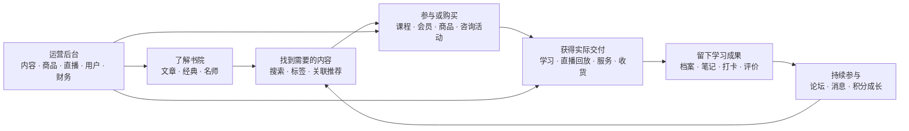
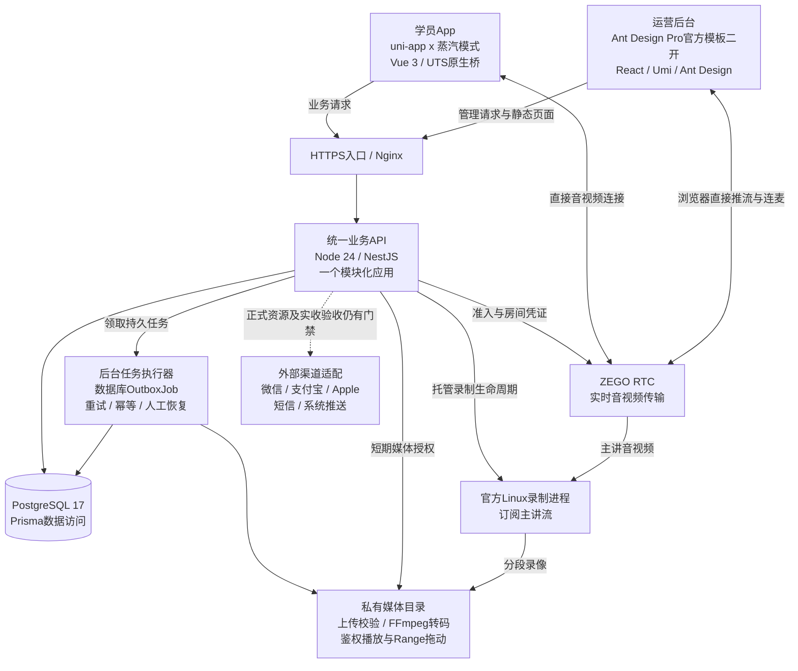
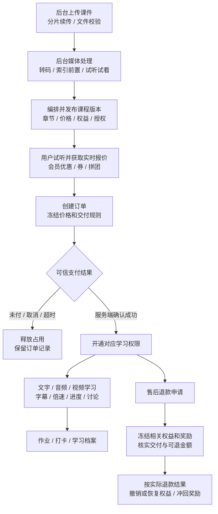
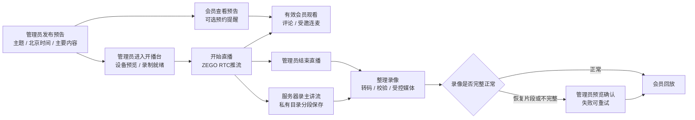

# 项目业务链路与架构总览

日期：2026-10-21。适用对象：项目负责人、运营和开发。

## 1. 一眼看懂这个项目

**用道学内容吸引用户，以课程、会员、商城和服务形成交易，再通过学习、直播、履约、社区与消息持续服务用户。**

图表示现有业务职责及正常流程，不表示每条链路均已通过正式商用验收。实现、上线、正式商用分别记录，当前商用基线仍为38/131。

## 2. 七个业务板块各自做什么

| 板块 | 后台准备 | 用户操作 | 交付结果与后续 |
| --- | --- | --- | --- |
| 文章与经典 | 来源/授权、正文、注释、审核发布、关联内容 | 阅读、选文笔记、收藏评论、分享 | 私人笔记/阅读历史、Markdown导出，导向课程和直播；真实授权材料仍需运营提供 |
| 名师 | 档案资质、代表课程、问答规则、预约日程 | 了解老师、提问、预约咨询 | 回复或实际咨询、评价与争议处理；付费服务按原订单记录实际履约 |
| 课程 | 上传文字/音频/视频、课程版本、价格和章节、直播/线下/营期安排 | 试听、购课、学习、作业打卡 | 固定版本学习权限、进度与档案，退款相应暂停/撤销权益；真实渠道和双端仍待验收 |
| 直播 | 管理员发布主题/时间/简介，同一入口开播结束 | 有效会员看直播、评论、受邀连麦、看回放 | ZEGO实时观看；服务器录主讲流，结束整理回放；无需分配老师审批，无礼物 |
| 论坛 | 板块话题、审核举报、精选征文 | 发帖、图文音视频、引用讨论 | 社区内容与治理记录，有效互动形成积分/成长；关联课程案例需授权 |
| 文化商城 | 实物/数字/服务商品、SKU、库存、运费与交付规则 | 选购、报价下单、收货/领取/预约、售后 | 实物发货签收、数字资料受控领取、服务实际履约；付款和各类售后需真实整体验收 |
| 会员 | 套餐和权益版本、有效期、优惠与配额 | 购买、续期、使用内容/折扣/问答/活动权益 | 按有效期与冻结规则授权，到期撤权，退款联动；自动续费R15尚未完成 |

活动、线下课、训练营属于课程与服务交付的延伸，保留在整体链路中。AI、虚拟名师、线上道场为R3展望，不作为当前已交付能力。

## 3. 技术架构：谁与谁连接

### 读图要点

- App和后台共享同一套业务规则与数据库。后台页面数不需要等于数据库表数，一次业务操作会涉及多张表。
- 后端为一个按业务模块组织的应用；当前持久任务使用PostgreSQL OutboxJob，不是已经部署Redis/BullMQ微服务集群。
- 音视频实时流经ZEGO，业务API负责会员权限、场次、凭证和状态。录制在服务器，不占管理员浏览器录制资源；管理员电脑仍须持续推流。
- 上传媒体和回放在当前服务器私有媒体卷，尚无已投用的COS/VOD/CDN证据。不能把选型建议画成已经接入。
- 收款、短信、系统推送的适配实现与正式开通/验收是两件事。站内消息保留；会员自动续费未完成。

## 4. 最高优先级：课程售卖到学习

关键边界：客户端显示“支付成功”不能直接开权限；支付回调/查单须经过服务端核验。大文件上传完成也不等于课件已经可售，仍需处理成功和发布版本。现有媒体单条小于2GiB，200MB以上上传和播放能力已有专项证据，双端长时/弱网商用表现另验。

## 5. 最新直播链路：管理员一站运营

管理员常用路径：[后台直播管理](https://academy.43-160-229-173.sslip.io/content/live) → 新建预告 → 到时进入开播台 → 检查摄像头/麦克风与录制 → 开始 → 结束 → 查看回放处理结果。操作指南在[直播工作流](https://academy.43-160-229-173.sslip.io/guide?workflow=live)。

当前录制仅主讲单流，观众连麦不进入录像。开播至少2GiB空闲，录制低于512MiB停止并提示；当前约5.7GB可用空间，需继续解决长时录像容量。服务已上线且录制ready，尚不等于新的公网开播/结束/回放及多人长时均已验收。

## 6. 交易、权益、交付和财务如何接起来

| 业务 | 付款后用户得到什么 | 实际交付在哪里发生 | 退款还要联动什么 |
| --- | --- | --- | --- |
| 课程 | 对应固定课程版本权限 | 播放学习、作业、直播/线下/营期 | 学习权限、冻结状态、奖励与渠道退款 |
| 会员 | 有效期及对应权益版本 | 内容访问、优惠、配额、活动权益 | 剩余期限、已使用权益、积分/成长 |
| 实物 | 待发货订单 | 发货、签收与售后 | 库存、运费规则、实际已退金额 |
| 数字资料 | 指定版本领取权 | 受控下载/领取 | 领取事实、授权撤销、退款条件 |
| 咨询/活动/营期 | 预约席位/参加资格 | 实际咨询、参与、签到、服务凭证 | 席位、延期取消、补偿、收入与奖励 |

**已付款、已交付、已确认收入是三个独立事实。** 服务收入根据实际履约和独立财务复核确认；订单金额不能直接当作最终可结算收入。合作分成、渠道日对账、合作方结算仍按26继续补齐。

会员权益决定“能做什么”；积分决定“可兑换多少”；成长决定“等级进展”。它们独立记账，退款和无效行为按原来源冲回，不混用。

## 7. 后台怎样组织才容易使用

按工作目的进入，而不是按表找页面：

| 工作 | 主要入口 | 完成标准 |
| --- | --- | --- |
| 发布内容 | 文章、名师、课程、商城 | 内容与授权齐备，媒体处理好，发布后用户实际可见 |
| 经营直播 | 直播管理、开播台 | 一次直播从预告到回放都能追踪 |
| 交付订单 | 订单、预约、活动/营期、售后 | 钱、席位/库存、交付与退款状态一致 |
| 服务学员 | 用户、会员、学习、消息、社区治理 | 权限正确，能查到具体问题和处理记录 |
| 核对经营 | 工作台、财务、任务监控 | 看待办与异常，收入/退款有事实和凭证 |
| 管理系统 | 权限菜单、配置、审计、操作指南 | 操作可授权、可追溯，故障可恢复 |

## 8. 当前上线范围与阅读入口

截至本次：API与后台版本`20261021-live-recording-01`，73条迁移、191张public表（含迁移记录）；官方Linux录制已启用，9组公网检查通过，6类核心业务计数一致。

本次没有生成新APK，已安装App不会自动获得本地`.uvue`修改。没有将部署或接口就绪计作真实长时直播、正式收退款、短信推送、iOS原生或上架验收。现有源码也存在待完成项，不能仅按页面数量给完成率。

- 当前状态与缺口：[83](83-status-and-gaps-2026-10-19.md)
- 开发顺序与逐项验收：[26](26-remaining-development-plan.md)
- 线上版本、备份和回退：[24](24-online-deployment.md)
- 最新直播规则与录制限制：[85](85-live-admin-simplification.md)、[86](86-live-ui-and-interaction-polish.md)
- 原始七板块业务及验收依据：[01](01-product-requirements.md)
