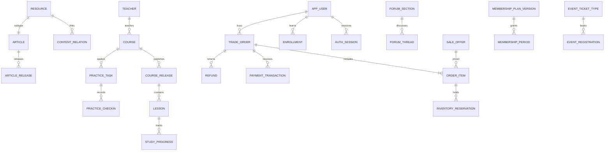

# 完整目标数据库表结构设计（R1 + R2）

日期：2026-10-09。**本文件为目标设计，不是已实现结构。** 现状29表逐列字典见[01a-database-current.md](01a-database-current.md)。本设计共 **144表**，覆盖原文七板块、基础功能、内容联动、收入结算和治理；R3 AI/虚拟名师/线上道场不建表。单体Nest/Prisma/PostgreSQL内按领域分模块，表多不等于要做微服务；R2表按其依赖分阶段建，不一次性上线。

逐表给出全列、主外键、唯一/检查约束及查询索引。参考SQL：[database-target-reference.sql](database-target-reference.sql)；机器可读结构：[target-schema-data.json](target-schema-data.json)。参考DDL未执行，也没有经实际PostgreSQL空库解析；不能直接替代当前Prisma迁移。跨行规则另列事务/触发器契约，不假装普通CHECK能保证跨表正确性。

## 统一约定

- 表与列采用snake_case；现有CamelCase实体以渐进迁移映射，绝不直接删库。ID仍text存UUID，由应用生成，避免现有text主键强制改型。事务API按字符串传ID。
- 每表都有id主键、created_at；可变表还有updated_at及version。updated_at由写服务统一更新、version采用乐观并发；参考DDL未创建自动更新触发器。账本/版本表不修改，纠错用新版本/冲正事件。
- 时间为timestamptz，存UTC；业务日期date按Asia/Shanghai生成。手机号/地址/联系与收款信息用cipher存加密值；检索/唯一以加密前规范化值的带密钥哈希hash实现。密钥不入表；日志不输出明文。
- 金额bigint存最小币种单位，CNY为分；传App以字符串或安全范围整数。currency+minor_exponent参与核验，商店本地化币种不套人民币金额。费率用万分比basis_points，不用浮点金额。
- 未标NOT NULL的列可空；除明确DEFAULT的列外不生成隐式默认。外键默认NO ACTION/RESTRICT，禁止交易、账本、版本级联删除。需要匿名化时保留app_user匿名主体，删除本人私密数据按专门作业执行。
- state/review_state/种类等受本文件状态机契约约束。核心钱与权益状态已有SQL CHECK；未列CHECK的业务枚举由DTO校验及迁移补齐，不能宣传SQL已穷尽全部业务约束。
- resource是发布状态、可见性、标题封面的唯一权威；文章/名师/课程/商品/活动/直播/帖子子表用同一id和resource_kind复合FK保证类型。不能维护第二套冲突发布状态。
- JSON存有版本的内容块、权益规则、渠道证据/快照，不代替金额、FK、库存和账本；响应asset_ids从attachment_binding派生，表内不再重复保存附件数组；benefit_scope管理权益指定资源/offer/分类的强FK范围。
- 外键高频查询列按所列组合索引查询；原SQL未为每个冷门FK机械建索引，新增业务时以查询计划决定。实时缓存/搜索索引可重建，不是资金事实来源。

## 关系总览

## 表目录

| 表 | 模块 | 阶段 | 与现状关系 | 用途 |
|---|---|---|---|---|
|app_user|身份|R1|扩展User|游客之外的统一账号，注销保留匿名交易主体|
|auth_identity|身份|R2|新增|微信/Apple身份绑定，手机号继续由app_user管理|
|auth_session|身份|R1|扩展AuthSession|APP/ADMIN短期access及可撤销refresh会话|
|consumed_refresh|身份|R1|保留ConsumedRefresh|已消费刷新令牌，重放撤销原会话|
|otp_challenge|身份|R1|扩展OtpChallenge|短信挑战，不存明文验证码|
|rate_limit|身份|R1|保留RateLimit|基础数据库限流，必要时缓存加速|
|access_role|身份|R1|替代roles枚举配置|角色与权限码，权限码目录由代码版本维护|
|user_role|身份|R1|新增|多角色授予；老师资源归属仍由teacher_staff/course_staff约束|
|tag|身份内容|R1|规范化tags|兴趣和资源标签字典|
|user_tag|身份内容|R1|替代User.tags|用户自主兴趣|
|consent_record|身份|R1|新增|政策版本和非必要数据处理同意/撤回|
|media_asset|内容|R1|扩展MediaAsset|对象存储元数据、转码和审核；长期URL不出现在用户响应|
|resource|内容|R1|新增统一资源注册|强FK的公共内容身份；此表是发布状态唯一权威|
|resource_tag|内容|R1|新增|资源标签关系|
|source_evidence|内容治理|R1|新增|经典版本、译注版权、名师背景、文化溯源及资质证据|
|resource_evidence|内容治理|R1|新增|资源与核验证据关联|
|content_relation|内容|R1|新增|文章名师课程直播商品活动的强FK联动|
|article|文章|R1|重构Article|文章资源子类型，当前发布版指针与编辑版本|
|article_release|文章|R1|新增|不变文章正文版本，保留授权与来源快照|
|article_block|文章|R1|替代blocks JSON|稳定段落键+发布版本正文；图文音视频引用块|
|reaction|内容互动|R1|扩展Favorite|资源统一点赞/收藏，计数由事实重算|
|reading_event|内容互动|R1|新增|阅读历史、去重和行为推荐事实；有限期保留|
|private_note|文章|R1/R2|扩展Note|私人摘录；删除资源后原文引用仍保留|
|note_export|文章|R2|新增|本人笔记导出任务，按筛选及权限生成短期文件|
|practice_log|实践|R1|扩展PracticeLog|私人日记，不直接公开；日期按上海业务时区|
|teacher|名师|R1|扩展Teacher|名师审核档案，账号绑定与后台角色分开|
|teacher_staff|名师|R1|新增|名师助理资源范围委派|
|teacher_question|名师|R1|新增|私问或申请公开，会员问答额度关联|
|teacher_answer|名师|R1|新增|答复版本及审核，精选标记|
|service_offering|名师|R1|新增|一对一与见面服务定义，同商城服务共用|
|appointment_slot|名师|R1|新增|唯一服务时段库存，不能在商品另维护库存|
|appointment|名师|R1|新增|付款/免费权益确认预约及交付，隐私联系信息加密|
|course|课程|R1|扩展Course|四类五形式课程定义，独立已购版本不得覆盖|
|course_chapter|课程|R1|扩展CourseChapter|草稿章节稳定ID；编辑不得全部重建键|
|course_release|课程|R1|扩展CourseRelease|不可变交付快照，作者授权、时效退课规则固定|
|lesson|课程|R1|扩展Lesson|发布章节快照，支持音视频文字直播线下|
|course_cohort|课程|R1/R2|新增|开营批次容量时间、固定发布版与助教|
|course_staff|课程|R1|新增|老师和助教按课程及可选营期授权|
|enrollment|课程|R1|重构Enrollment|每笔独立来源的课程授权，避免退款误撤其他购课权|
|study_progress|课程|R1|扩展StudyProgress|一用户一发布版章节的续播及完成|
|study_event|课程|R1|扩展StudyEvent|客户端持久队列的幂等学习事实|
|assignment|课程实践|R1|新增|必修作业和期限，营期可选|
|submission|课程实践|R1/R2|新增|学员作业修订版本，附件绑定媒体|
|teacher_review|课程实践|R1|新增|作业或实践点评，恰好一个来源|
|practice_task|课程实践|R1|新增|课程每日/周期实践定义及打卡要求|
|practice_checkin|课程实践|R1|新增|任务打卡不同于私人日志；连续天数按日期事实推导|
|offline_license|课程|R2|新增|离线文件设备授权，不存明文永久解密密钥|
|forum_section|社群|R1|新增|六区及受限课程讨论；共用帖子能力|
|forum_thread|社群|R1/R2|新增|帖子资源子类型，图文音视频块和引用|
|comment|社群内容|R1|新增|文章论坛直播评论与引用；所有目标指向资源|
|user_block|治理|R1|新增|本人拉黑关系|
|report|治理|R1|新增|举报资源或评论，恰好一个目标|
|moderation_action|治理|R1|新增|审核处置和申诉，保存前后状态可恢复|
|user_restriction|治理|R1|新增|禁言封禁跨入口统一执行|
|content_authorization|治理|R1/R2|新增|自愿公开私人摘录/日志或使用用户内容作课程案例的授权|
|writing_campaign|社群|R2|新增|主题征文活动及规则奖品|
|campaign_entry|社群|R2|新增|投稿评选和授权|
|live_room|直播|R1|新增|长期房间定义，不存裸推流密钥|
|live_session|直播|R1|新增|单场直播生命周期及媒体服务状态|
|live_reservation|直播|R1|新增|预约开播提醒|
|live_replay|直播|R1|新增|审核回放，固定准入规则和关联课|
|live_mic_request|直播|R2|新增|连麦申请批准与结束，RTC凭证临时生成|
|live_poll|直播|R2|新增|直播投票问卷|
|poll_option|直播|R2|新增|投票选项|
|poll_vote|直播|R2|新增|每次投票用户选项去重；单选限制服务事务检查|
|virtual_gift|直播|R2|新增|古风礼物商品和消费单位，价格由offer决定|
|gift_wallet|直播|R2|新增|购买余额独立于免费积分，不设自动过期|
|gift_ledger|直播|R2|新增|礼物充值消费退款不可变流水|
|product|商城|R1|扩展Product|五类商品描述与溯源，履约类型单独定义|
|product_sku|商城|R1|扩展ProductSku|实物库存聚合，数字/服务不得冒用此库存|
|digital_release|商城|R1/R2|新增|数字资料不可变版本与使用期限|
|digital_release_asset|商城|R1|新增|数字资料包文件顺序|
|sale_offer|交易|R1|新增统一可售单元|唯一计价和渠道映射对象，恰好一种交付源|
|channel_product_mapping|交易|R1|新增|渠道商品ID、平台价格币种和校验；商店价格与CNY报价分开|
|cart_item|商城|R1|扩展CartItem|实物购物车引用可售单元|
|address|商城|R1|扩展Address|私人地址加密，订单另留不可变快照|
|delivery_template|商城|R1|扩展DeliveryZone父级|不同商品配送规则及售前说明|
|delivery_zone|商城|R1/R2|扩展DeliveryZone|区域覆盖与基础/附加/续件费及优先配送|
|trade_order|交易|R1|替代开发Order|订单商务状态与支付/退款分离；不同履约种类不混单|
|order_item|交易|R1|扩展OrderItem|逐项价格、权益、合作方、履约及折扣运费快照|
|inventory_reservation|交易|R1|新增|商品/时段/席位/营期预占的明细，超时任务按事实释放|
|inventory_ledger|交易|R1|新增|实物库存入库预占释放销售退款回库可追溯|
|payment_attempt|交易|R1|新增|一次渠道付款尝试，不把客户端返回当成功|
|payment_transaction|交易|R1|新增|保存每次实际渠道收款，包括重复付款异常，事实不得丢弃|
|provider_callback|交易运维|R1|新增|支付退款直播转码审核统一回调收件箱|
|refund|交易|R1|新增|售后申请与退款请求；换货不伪装现金退款|
|refund_item|交易|R1|新增|按订单项部分退款和退货范围，避免整单撤权|
|shipment|商城|R1/R2|新增|真实包裹、承运商单号签收及交换履约|
|shipment_item|商城|R1|新增|一单多包裹/退换件逐项数量|
|digital_delivery|商城|R1|新增|支付后领取权益，退款逐来源撤销|
|membership_plan|会员|R1|扩展MembershipPlan|套餐身份；三级与有效天数，价格权益放不变版本|
|membership_plan_version|会员|R1|新增|不可变权益与条款版本，成交固定|
|benefit_definition|会员|R1|新增|文章课程准入/折扣运费问答活动签名品权益码|
|plan_benefit|会员|R1/R2|新增|每个套餐版本具体权益参数和适用资源|
|membership_period|会员|R1|重构Membership|按购买/补偿来源排队的生效区间，时段不可重叠|
|benefit_usage|会员|R1/R2|新增|权益额度预占消费退还，取消可重试|
|growth_ledger|成长|R1/R2|新增|成长值不可变事实，不隐式升级付费会员|
|points_account|积分|R1|新增|积分余额聚合，锁账号防并发透支|
|points_ledger|积分|R1|新增|消费打卡审核奖励兑换及退款冲正|
|points_reservation|积分|R1|新增|兑换预占，失败释放|
|points_reward|积分|R1/R2|新增|积分兑换奖品券/实物/咨询，券R1其余R2|
|points_redemption|积分|R1/R2|新增|兑换订单关联实际奖励交付|
|event|活动|R1|扩展Event|讲座研学见面会线下课，时间席位下放场次|
|event_session|活动|R1|新增|单场时间地点、延期取消与核销范围|
|event_ticket_type|活动|R1/R2|新增|票种容量及售价由offer配置，多票种R2|
|event_registration|活动|R1|新增|免费也需报名，付费与会员额度共用席位|
|event_checkin|活动|R1|新增|核销幂等，工作者须在场次授权范围|
|event_staff|活动|R1|新增|场次工作人员授权|
|event_waitlist|活动|R2|新增|候补记录和限时补位邀请|
|coupon_template|营销|R1/R2|新增|积分券R1、营销券R2；一单一券择优策略|
|user_coupon|营销|R1/R2|新增|券领取锁定核销退回|
|promotion|营销|R2|新增|秒杀/满减活动服务端时间价格与独立库存|
|promotion_offer|营销|R2|新增|活动指定可售单元与限量|
|group_buy|营销|R2|新增|课程拼团规则/团价售卖映射，团成才发课权|
|group_buy_member|营销|R2|新增|拼团支付成员去重；失败逐单退款|
|referral|营销|R2|新增|一级推广批准与7天首次有效归因|
|commission_ledger|营销财务|R2|新增|佣金净实收及退款回冲，原始费率固定|
|withdrawal_request|营销财务|R2|新增|提现审批不等于付款；记录实际付款及防重复请求|
|partner|合作财务|R1|新增|名师机构文创品牌合作方，不等于开放商家入驻|
|partner_contract|合作财务|R1|新增|不变协议版本，公益特殊费率及收款分账|
|settlement|合作财务|R1/R2|新增|合作方月度或推广提现结算单，人工复核和实际打款|
|settlement_item|合作财务|R1|新增|每个收款/退款来源结算一次，差额结算用新事件|
|finance_journal|财务|R1|新增|支付退款费用合作应付总账事件，保存异常事实|
|finance_entry|财务|R1|新增|双式分录；每journal同币种借贷总和为0|
|reconciliation|财务|R1|新增|渠道每日对账任务与差异列表，不用示例营业额|
|operating_service|运营|R2|新增|名师推广策划服务合同报价交付，后台创建订单|
|ad_placement|运营|R2|新增|有标识广告推荐位，不伪装权威内容|
|ad_campaign|运营|R2|新增|广告排期与实际曝光点击汇总、合同交付|
|notification|消息|R1|新增|站内消息，业务事实提交后投递|
|device_token|消息|R1|新增|原生推送设备绑定与退出失效|
|notification_delivery|消息|R1|新增|推送重试不重复创建站内消息|
|feedback|客服|R1|新增|意见/售后咨询/电话回访工单|
|feedback_reply|客服|R1|新增|工单双向答复，内部备注不发用户|
|audit_log|运维治理|R1|扩展AuditLog|重要后台变更不可变审计，敏感内容脱敏|
|outbox_job|运维|R1|新增|与业务事务一同提交的持久可靠任务，worker租约重试|
|idempotency_record|运维|R1|新增|跨创建退款兑换报名操作幂等缓存，业务唯一约束仍兜底|
|feature_config|运维运营|R1|新增|带版本的业务规则与开关、实际客服联系方式、消息偏好默认|
|attachment_binding|媒体|R1|新增|统一附件关系，数组只是响应投影；关系表是外键权威|
|benefit_scope|会员|R1|新增|权益强FK范围，指定资源/可售单元/分类恰好一种|
|refund_transaction|交易|R1|新增|每笔已核验渠道退款事实，退重复异常收款不错误冲减正常订单|
|withdrawal_allocation|营销财务|R2|新增|提现占用佣金明细，失败释放，防同一余额同时申请|
|finance_account|财务|R1|新增|财务科目目录，平台收入、渠道费、合作应付、退款等|
|benefit_grant|会员成长|R1/R2|新增|成长/积分或人工赠权益的独立来源，不伪装付费会员|
|gift_credit_allocation|直播财务|R2|新增|礼物消费按购买来源分摊，付费余额池消费与老师收入可对账|

## 逐表全字段

### app_user

游客之外的统一账号，注销保留匿名交易主体。阶段：R1；现状关系：扩展User。

| 列 | 类型与空值/默认/列级规则 |
|---|---|
|id|`text PRIMARY KEY`|
|created_at|`timestamptz NOT NULL DEFAULT now()`|
|updated_at|`timestamptz NOT NULL DEFAULT now()`|
|version|`integer NOT NULL DEFAULT 1 CHECK (version > 0)`|
|phone_cipher|`text`|
|phone_hash|`text UNIQUE`|
|username|`text UNIQUE`|
|password_hash|`text`|
|nickname|`text NOT NULL`|
|avatar_asset_id|`text REFERENCES media_asset(id)`|
|status|`text NOT NULL DEFAULT 'ACTIVE'`|
|deleted_at|`timestamptz`|
|last_seen_at|`timestamptz`|

表级约束：`CHECK (status IN ('ACTIVE','FROZEN','DELETED'))`；`CHECK ((status='DELETED')=(deleted_at IS NOT NULL))`

查询索引：除PK/UNIQUE隐含索引外按查询计划增补。

### auth_identity

微信/Apple身份绑定，手机号继续由app_user管理。阶段：R2；现状关系：新增。

| 列 | 类型与空值/默认/列级规则 |
|---|---|
|id|`text PRIMARY KEY`|
|created_at|`timestamptz NOT NULL DEFAULT now()`|
|updated_at|`timestamptz NOT NULL DEFAULT now()`|
|version|`integer NOT NULL DEFAULT 1 CHECK (version > 0)`|
|user_id|`text NOT NULL REFERENCES app_user(id)`|
|provider|`text NOT NULL`|
|app_scope|`text NOT NULL`|
|subject_hash|`text NOT NULL`|
|union_subject_hash|`text`|
|verified_at|`timestamptz NOT NULL`|

表级约束：`UNIQUE(provider,app_scope,subject_hash)`

查询索引：`(user_id,provider)`

### auth_session

APP/ADMIN短期access及可撤销refresh会话。阶段：R1；现状关系：扩展AuthSession。

| 列 | 类型与空值/默认/列级规则 |
|---|---|
|id|`text PRIMARY KEY`|
|created_at|`timestamptz NOT NULL DEFAULT now()`|
|updated_at|`timestamptz NOT NULL DEFAULT now()`|
|version|`integer NOT NULL DEFAULT 1 CHECK (version > 0)`|
|user_id|`text NOT NULL REFERENCES app_user(id)`|
|kind|`text NOT NULL`|
|access_hash|`text NOT NULL UNIQUE`|
|refresh_hash|`text NOT NULL UNIQUE`|
|access_expires_at|`timestamptz NOT NULL`|
|refresh_expires_at|`timestamptz NOT NULL`|
|csrf_hash|`text`|
|device_id|`text`|
|revoked_at|`timestamptz`|

表级约束：`CHECK(kind IN ('APP','ADMIN'))`；`CHECK(refresh_expires_at>access_expires_at)`

查询索引：`(user_id,revoked_at)`

### consumed_refresh

已消费刷新令牌，重放撤销原会话。阶段：R1；现状关系：保留ConsumedRefresh。

| 列 | 类型与空值/默认/列级规则 |
|---|---|
|id|`text PRIMARY KEY`|
|created_at|`timestamptz NOT NULL DEFAULT now()`|
|token_hash|`text NOT NULL UNIQUE`|
|session_id|`text NOT NULL REFERENCES auth_session(id)`|
|expires_at|`timestamptz NOT NULL`|

表级约束：无额外表级约束，列级PK/FK/UNIQUE见上。

查询索引：`(expires_at)`

### otp_challenge

短信挑战，不存明文验证码。阶段：R1；现状关系：扩展OtpChallenge。

| 列 | 类型与空值/默认/列级规则 |
|---|---|
|id|`text PRIMARY KEY`|
|created_at|`timestamptz NOT NULL DEFAULT now()`|
|phone_hash|`text NOT NULL`|
|purpose|`text NOT NULL`|
|code_hash|`text NOT NULL`|
|attempts|`integer NOT NULL DEFAULT 0`|
|expires_at|`timestamptz NOT NULL`|
|consumed_at|`timestamptz`|
|provider_request_id|`text`|
|delivery_state|`text NOT NULL`|

表级约束：`CHECK(attempts BETWEEN 0 AND 5)`

查询索引：`(phone_hash,purpose,created_at)`

### rate_limit

基础数据库限流，必要时缓存加速。阶段：R1；现状关系：保留RateLimit。

| 列 | 类型与空值/默认/列级规则 |
|---|---|
|id|`text PRIMARY KEY`|
|created_at|`timestamptz NOT NULL DEFAULT now()`|
|updated_at|`timestamptz NOT NULL DEFAULT now()`|
|version|`integer NOT NULL DEFAULT 1 CHECK (version > 0)`|
|limit_key|`text NOT NULL UNIQUE`|
|count|`integer NOT NULL`|
|expires_at|`timestamptz NOT NULL`|

表级约束：`CHECK(count>=0)`

查询索引：`(expires_at)`

### access_role

角色与权限码，权限码目录由代码版本维护。阶段：R1；现状关系：替代roles枚举配置。

| 列 | 类型与空值/默认/列级规则 |
|---|---|
|id|`text PRIMARY KEY`|
|created_at|`timestamptz NOT NULL DEFAULT now()`|
|updated_at|`timestamptz NOT NULL DEFAULT now()`|
|version|`integer NOT NULL DEFAULT 1 CHECK (version > 0)`|
|code|`text NOT NULL UNIQUE`|
|name|`text NOT NULL`|
|permission_codes|`text[] NOT NULL DEFAULT '{}'`|
|active|`boolean NOT NULL DEFAULT true`|

表级约束：无额外表级约束，列级PK/FK/UNIQUE见上。

查询索引：除PK/UNIQUE隐含索引外按查询计划增补。

### user_role

多角色授予；老师资源归属仍由teacher_staff/course_staff约束。阶段：R1；现状关系：新增。

| 列 | 类型与空值/默认/列级规则 |
|---|---|
|id|`text PRIMARY KEY`|
|created_at|`timestamptz NOT NULL DEFAULT now()`|
|updated_at|`timestamptz NOT NULL DEFAULT now()`|
|version|`integer NOT NULL DEFAULT 1 CHECK (version > 0)`|
|user_id|`text NOT NULL REFERENCES app_user(id)`|
|role_id|`text NOT NULL REFERENCES access_role(id)`|
|granted_by|`text NOT NULL REFERENCES app_user(id)`|
|reason|`text NOT NULL`|
|revoked_at|`timestamptz`|

表级约束：无额外表级约束，列级PK/FK/UNIQUE见上。

查询索引：`(user_id,role_id) WHERE revoked_at IS NULL UNIQUE`

### tag

兴趣和资源标签字典。阶段：R1；现状关系：规范化tags。

| 列 | 类型与空值/默认/列级规则 |
|---|---|
|id|`text PRIMARY KEY`|
|created_at|`timestamptz NOT NULL DEFAULT now()`|
|updated_at|`timestamptz NOT NULL DEFAULT now()`|
|version|`integer NOT NULL DEFAULT 1 CHECK (version > 0)`|
|code|`text NOT NULL UNIQUE`|
|name|`text NOT NULL`|
|parent_id|`text REFERENCES tag(id)`|
|active|`boolean NOT NULL DEFAULT true`|

表级约束：无额外表级约束，列级PK/FK/UNIQUE见上。

查询索引：除PK/UNIQUE隐含索引外按查询计划增补。

### user_tag

用户自主兴趣。阶段：R1；现状关系：替代User.tags。

| 列 | 类型与空值/默认/列级规则 |
|---|---|
|id|`text PRIMARY KEY`|
|created_at|`timestamptz NOT NULL DEFAULT now()`|
|user_id|`text NOT NULL REFERENCES app_user(id)`|
|tag_id|`text NOT NULL REFERENCES tag(id)`|

表级约束：`UNIQUE(user_id,tag_id)`

查询索引：除PK/UNIQUE隐含索引外按查询计划增补。

### consent_record

政策版本和非必要数据处理同意/撤回。阶段：R1；现状关系：新增。

| 列 | 类型与空值/默认/列级规则 |
|---|---|
|id|`text PRIMARY KEY`|
|created_at|`timestamptz NOT NULL DEFAULT now()`|
|user_id|`text NOT NULL REFERENCES app_user(id)`|
|policy_code|`text NOT NULL`|
|policy_version|`text NOT NULL`|
|purpose|`text NOT NULL`|
|accepted|`boolean NOT NULL`|
|acted_at|`timestamptz NOT NULL`|
|source|`text NOT NULL`|

表级约束：无额外表级约束，列级PK/FK/UNIQUE见上。

查询索引：`(user_id,purpose,acted_at)`

### media_asset

对象存储元数据、转码和审核；长期URL不出现在用户响应。阶段：R1；现状关系：扩展MediaAsset。

| 列 | 类型与空值/默认/列级规则 |
|---|---|
|id|`text PRIMARY KEY`|
|created_at|`timestamptz NOT NULL DEFAULT now()`|
|updated_at|`timestamptz NOT NULL DEFAULT now()`|
|version|`integer NOT NULL DEFAULT 1 CHECK (version > 0)`|
|uploader_id|`text NOT NULL REFERENCES app_user(id)`|
|storage_key|`text NOT NULL UNIQUE`|
|name|`text NOT NULL`|
|mime|`text NOT NULL`|
|bytes|`bigint NOT NULL`|
|sha256|`text NOT NULL`|
|status|`text NOT NULL`|
|visibility|`text NOT NULL`|
|duration_seconds|`integer`|
|provider_asset_id|`text`|
|variants|`jsonb NOT NULL DEFAULT '{}'`|
|failure_code|`text`|

表级约束：`CHECK(bytes>=0)`；`CHECK(duration_seconds IS NULL OR duration_seconds>=0)`；`CHECK(status IN ('UPLOADING','PROCESSING','REVIEW','READY','REJECTED','DELETED'))`

查询索引：`(uploader_id,created_at)`；`(status,created_at)`

### resource

强FK的公共内容身份；此表是发布状态唯一权威。阶段：R1；现状关系：新增统一资源注册。

| 列 | 类型与空值/默认/列级规则 |
|---|---|
|id|`text PRIMARY KEY`|
|created_at|`timestamptz NOT NULL DEFAULT now()`|
|updated_at|`timestamptz NOT NULL DEFAULT now()`|
|version|`integer NOT NULL DEFAULT 1 CHECK (version > 0)`|
|kind|`text NOT NULL`|
|title|`text NOT NULL`|
|summary|`text NOT NULL DEFAULT ''`|
|cover_asset_id|`text REFERENCES media_asset(id)`|
|owner_id|`text REFERENCES app_user(id)`|
|publish_state|`text NOT NULL DEFAULT 'DRAFT'`|
|visibility|`text NOT NULL DEFAULT 'PUBLIC'`|
|membership_tier|`integer`|
|category_code|`text NOT NULL`|
|is_demo|`boolean NOT NULL DEFAULT false`|
|featured_rank|`integer`|
|published_at|`timestamptz`|

表级约束：`UNIQUE(id,kind)`；`CHECK(kind IN ('ARTICLE','TEACHER','COURSE','PRODUCT','EVENT','LIVE','THREAD'))`；`CHECK(publish_state IN ('DRAFT','REVIEW','PUBLISHED','REJECTED','ARCHIVED'))`；`CHECK(visibility IN ('PUBLIC','MEMBER','COURSE','PRIVATE'))`；`CHECK(membership_tier IS NULL OR membership_tier BETWEEN 1 AND 3)`

查询索引：`(kind,publish_state,published_at,id)`；`(kind,category_code,publish_state)`

### resource_tag

资源标签关系。阶段：R1；现状关系：新增。

| 列 | 类型与空值/默认/列级规则 |
|---|---|
|id|`text PRIMARY KEY`|
|created_at|`timestamptz NOT NULL DEFAULT now()`|
|resource_id|`text NOT NULL REFERENCES resource(id)`|
|tag_id|`text NOT NULL REFERENCES tag(id)`|

表级约束：`UNIQUE(resource_id,tag_id)`

查询索引：除PK/UNIQUE隐含索引外按查询计划增补。

### source_evidence

经典版本、译注版权、名师背景、文化溯源及资质证据。阶段：R1；现状关系：新增。

| 列 | 类型与空值/默认/列级规则 |
|---|---|
|id|`text PRIMARY KEY`|
|created_at|`timestamptz NOT NULL DEFAULT now()`|
|updated_at|`timestamptz NOT NULL DEFAULT now()`|
|version|`integer NOT NULL DEFAULT 1 CHECK (version > 0)`|
|kind|`text NOT NULL`|
|title|`text NOT NULL`|
|author|`text`|
|edition|`text`|
|source_url|`text`|
|proof_asset_id|`text REFERENCES media_asset(id)`|
|rights_holder|`text`|
|license_scope|`text`|
|valid_from|`timestamptz`|
|valid_until|`timestamptz`|
|review_state|`text NOT NULL`|
|reviewer_id|`text REFERENCES app_user(id)`|
|review_note|`text`|

表级约束：`CHECK(valid_until IS NULL OR valid_from IS NULL OR valid_until>valid_from)`

查询索引：除PK/UNIQUE隐含索引外按查询计划增补。

### resource_evidence

资源与核验证据关联。阶段：R1；现状关系：新增。

| 列 | 类型与空值/默认/列级规则 |
|---|---|
|id|`text PRIMARY KEY`|
|created_at|`timestamptz NOT NULL DEFAULT now()`|
|resource_id|`text NOT NULL REFERENCES resource(id)`|
|evidence_id|`text NOT NULL REFERENCES source_evidence(id)`|
|purpose|`text NOT NULL`|

表级约束：`UNIQUE(resource_id,evidence_id,purpose)`

查询索引：除PK/UNIQUE隐含索引外按查询计划增补。

### content_relation

文章名师课程直播商品活动的强FK联动。阶段：R1；现状关系：新增。

| 列 | 类型与空值/默认/列级规则 |
|---|---|
|id|`text PRIMARY KEY`|
|created_at|`timestamptz NOT NULL DEFAULT now()`|
|updated_at|`timestamptz NOT NULL DEFAULT now()`|
|version|`integer NOT NULL DEFAULT 1 CHECK (version > 0)`|
|from_id|`text NOT NULL REFERENCES resource(id)`|
|to_id|`text NOT NULL REFERENCES resource(id)`|
|relation_type|`text NOT NULL`|
|rank|`integer NOT NULL DEFAULT 0`|
|starts_at|`timestamptz`|
|ends_at|`timestamptz`|
|approved_by|`text REFERENCES app_user(id)`|

表级约束：`UNIQUE(from_id,to_id,relation_type)`；`CHECK(from_id<>to_id)`；`CHECK(ends_at IS NULL OR starts_at IS NULL OR ends_at>starts_at)`

查询索引：`(from_id,relation_type,rank)`

### article

文章资源子类型，当前发布版指针与编辑版本。阶段：R1；现状关系：重构Article。

| 列 | 类型与空值/默认/列级规则 |
|---|---|
|id|`text PRIMARY KEY`|
|created_at|`timestamptz NOT NULL DEFAULT now()`|
|updated_at|`timestamptz NOT NULL DEFAULT now()`|
|version|`integer NOT NULL DEFAULT 1 CHECK (version > 0)`|
|resource_kind|`text NOT NULL DEFAULT 'ARTICLE' CHECK (resource_kind = 'ARTICLE')`|
|author_display|`text NOT NULL`|
|author_user_id|`text REFERENCES app_user(id)`|
|current_release_id|`text REFERENCES article_release(id)`|
|draft_blocks|`jsonb NOT NULL DEFAULT '[]'`|
|draft_source_snapshot|`jsonb NOT NULL DEFAULT '{}'`|
|draft_template_code|`text`|

表级约束：`FOREIGN KEY (id, resource_kind) REFERENCES resource(id, kind)`；`FOREIGN KEY(current_release_id,id) REFERENCES article_release(id,article_id)`

查询索引：除PK/UNIQUE隐含索引外按查询计划增补。

### article_release

不变文章正文版本，保留授权与来源快照。阶段：R1；现状关系：新增。

| 列 | 类型与空值/默认/列级规则 |
|---|---|
|id|`text PRIMARY KEY`|
|created_at|`timestamptz NOT NULL DEFAULT now()`|
|article_id|`text NOT NULL REFERENCES article(id)`|
|release_no|`integer NOT NULL`|
|source_snapshot|`jsonb NOT NULL`|
|author_snapshot|`jsonb NOT NULL`|
|reviewer_id|`text NOT NULL REFERENCES app_user(id)`|
|published_at|`timestamptz NOT NULL`|

表级约束：`UNIQUE(article_id,release_no)`；`UNIQUE(id,article_id)`

查询索引：除PK/UNIQUE隐含索引外按查询计划增补。

### article_block

稳定段落键+发布版本正文；图文音视频引用块。阶段：R1；现状关系：替代blocks JSON。

| 列 | 类型与空值/默认/列级规则 |
|---|---|
|id|`text PRIMARY KEY`|
|created_at|`timestamptz NOT NULL DEFAULT now()`|
|release_id|`text NOT NULL REFERENCES article_release(id)`|
|stable_key|`text NOT NULL`|
|position|`integer NOT NULL`|
|kind|`text NOT NULL`|
|body|`jsonb NOT NULL`|
|media_id|`text REFERENCES media_asset(id)`|
|citation_evidence_id|`text REFERENCES source_evidence(id)`|

表级约束：`UNIQUE(release_id,stable_key)`；`UNIQUE(release_id,position)`；`CHECK(position>=0)`；`CHECK(kind IN ('PARAGRAPH','QUOTE','IMAGE','AUDIO','VIDEO'))`

查询索引：除PK/UNIQUE隐含索引外按查询计划增补。

### reaction

资源统一点赞/收藏，计数由事实重算。阶段：R1；现状关系：扩展Favorite。

| 列 | 类型与空值/默认/列级规则 |
|---|---|
|id|`text PRIMARY KEY`|
|created_at|`timestamptz NOT NULL DEFAULT now()`|
|user_id|`text NOT NULL REFERENCES app_user(id)`|
|resource_id|`text NOT NULL REFERENCES resource(id)`|
|kind|`text NOT NULL`|

表级约束：`UNIQUE(user_id,resource_id,kind)`；`CHECK(kind IN ('LIKE','FAVORITE'))`

查询索引：`(resource_id,kind)`

### reading_event

阅读历史、去重和行为推荐事实；有限期保留。阶段：R1；现状关系：新增。

| 列 | 类型与空值/默认/列级规则 |
|---|---|
|id|`text PRIMARY KEY`|
|created_at|`timestamptz NOT NULL DEFAULT now()`|
|user_id|`text REFERENCES app_user(id)`|
|anonymous_hash|`text`|
|resource_id|`text NOT NULL REFERENCES resource(id)`|
|event_key|`text NOT NULL UNIQUE`|
|business_day|`date NOT NULL`|
|dwell_seconds|`integer NOT NULL DEFAULT 0`|
|consent_record_id|`text REFERENCES consent_record(id)`|

表级约束：`CHECK(dwell_seconds>=0)`

查询索引：`(user_id,created_at)`；`(resource_id,business_day)`

### private_note

私人摘录；删除资源后原文引用仍保留。阶段：R1/R2；现状关系：扩展Note。

| 列 | 类型与空值/默认/列级规则 |
|---|---|
|id|`text PRIMARY KEY`|
|created_at|`timestamptz NOT NULL DEFAULT now()`|
|updated_at|`timestamptz NOT NULL DEFAULT now()`|
|version|`integer NOT NULL DEFAULT 1 CHECK (version > 0)`|
|user_id|`text NOT NULL REFERENCES app_user(id)`|
|article_id|`text REFERENCES article(id)`|
|release_id|`text REFERENCES article_release(id)`|
|block_stable_key|`text NOT NULL`|
|range_start|`integer`|
|range_end|`integer`|
|title_snapshot|`text NOT NULL`|
|quote_snapshot|`text NOT NULL`|
|note_text|`text NOT NULL`|
|deleted_at|`timestamptz`|

表级约束：`CHECK((range_start IS NULL AND range_end IS NULL) OR (range_start>=0 AND range_end>range_start))`

查询索引：`(user_id,updated_at,id)`

### note_export

本人笔记导出任务，按筛选及权限生成短期文件。阶段：R2；现状关系：新增。

| 列 | 类型与空值/默认/列级规则 |
|---|---|
|id|`text PRIMARY KEY`|
|created_at|`timestamptz NOT NULL DEFAULT now()`|
|updated_at|`timestamptz NOT NULL DEFAULT now()`|
|version|`integer NOT NULL DEFAULT 1 CHECK (version > 0)`|
|user_id|`text NOT NULL REFERENCES app_user(id)`|
|request_key|`text NOT NULL`|
|filter_snapshot|`jsonb NOT NULL`|
|format|`text NOT NULL`|
|state|`text NOT NULL`|
|asset_id|`text REFERENCES media_asset(id)`|
|expires_at|`timestamptz`|
|error_code|`text`|

表级约束：`UNIQUE(user_id,request_key)`

查询索引：`(state,created_at)`

### practice_log

私人日记，不直接公开；日期按上海业务时区。阶段：R1；现状关系：扩展PracticeLog。

| 列 | 类型与空值/默认/列级规则 |
|---|---|
|id|`text PRIMARY KEY`|
|created_at|`timestamptz NOT NULL DEFAULT now()`|
|updated_at|`timestamptz NOT NULL DEFAULT now()`|
|version|`integer NOT NULL DEFAULT 1 CHECK (version > 0)`|
|user_id|`text NOT NULL REFERENCES app_user(id)`|
|business_day|`date NOT NULL`|
|text|`text NOT NULL`|
|deleted_at|`timestamptz`|

表级约束：`UNIQUE(user_id,business_day)`

查询索引：`(user_id,business_day)`

### teacher

名师审核档案，账号绑定与后台角色分开。阶段：R1；现状关系：扩展Teacher。

| 列 | 类型与空值/默认/列级规则 |
|---|---|
|id|`text PRIMARY KEY`|
|created_at|`timestamptz NOT NULL DEFAULT now()`|
|updated_at|`timestamptz NOT NULL DEFAULT now()`|
|version|`integer NOT NULL DEFAULT 1 CHECK (version > 0)`|
|resource_kind|`text NOT NULL DEFAULT 'TEACHER' CHECK (resource_kind = 'TEACHER')`|
|user_id|`text UNIQUE REFERENCES app_user(id)`|
|honor_title|`text NOT NULL`|
|bio|`text NOT NULL`|
|lineage_summary|`text`|
|achievement_summary|`text`|
|teaching_direction|`text NOT NULL`|
|service_policy|`text`|
|portrait_asset_id|`text REFERENCES media_asset(id)`|

表级约束：`FOREIGN KEY (id, resource_kind) REFERENCES resource(id, kind)`

查询索引：除PK/UNIQUE隐含索引外按查询计划增补。

### teacher_staff

名师助理资源范围委派。阶段：R1；现状关系：新增。

| 列 | 类型与空值/默认/列级规则 |
|---|---|
|id|`text PRIMARY KEY`|
|created_at|`timestamptz NOT NULL DEFAULT now()`|
|updated_at|`timestamptz NOT NULL DEFAULT now()`|
|version|`integer NOT NULL DEFAULT 1 CHECK (version > 0)`|
|teacher_id|`text NOT NULL REFERENCES teacher(id)`|
|user_id|`text NOT NULL REFERENCES app_user(id)`|
|scope_codes|`text[] NOT NULL`|
|revoked_at|`timestamptz`|

表级约束：无额外表级约束，列级PK/FK/UNIQUE见上。

查询索引：`(teacher_id,user_id) WHERE revoked_at IS NULL UNIQUE`

### teacher_question

私问或申请公开，会员问答额度关联。阶段：R1；现状关系：新增。

| 列 | 类型与空值/默认/列级规则 |
|---|---|
|id|`text PRIMARY KEY`|
|created_at|`timestamptz NOT NULL DEFAULT now()`|
|updated_at|`timestamptz NOT NULL DEFAULT now()`|
|version|`integer NOT NULL DEFAULT 1 CHECK (version > 0)`|
|teacher_id|`text NOT NULL REFERENCES teacher(id)`|
|user_id|`text NOT NULL REFERENCES app_user(id)`|
|body|`text NOT NULL`|
|visibility|`text NOT NULL`|
|state|`text NOT NULL`|
|benefit_usage_id|`text REFERENCES benefit_usage(id)`|
|answered_at|`timestamptz`|

表级约束：`CHECK(visibility IN ('PRIVATE','PUBLIC'))`；`CHECK(state IN ('OPEN','ANSWERED','CLOSED','REJECTED'))`

查询索引：`(teacher_id,state,created_at)`；`(user_id,created_at)`

### teacher_answer

答复版本及审核，精选标记。阶段：R1；现状关系：新增。

| 列 | 类型与空值/默认/列级规则 |
|---|---|
|id|`text PRIMARY KEY`|
|created_at|`timestamptz NOT NULL DEFAULT now()`|
|updated_at|`timestamptz NOT NULL DEFAULT now()`|
|version|`integer NOT NULL DEFAULT 1 CHECK (version > 0)`|
|question_id|`text NOT NULL REFERENCES teacher_question(id)`|
|author_id|`text NOT NULL REFERENCES app_user(id)`|
|body|`text NOT NULL`|
|asset_id|`text REFERENCES media_asset(id)`|
|review_state|`text NOT NULL`|
|featured|`boolean NOT NULL DEFAULT false`|
|reviewer_id|`text REFERENCES app_user(id)`|

表级约束：无额外表级约束，列级PK/FK/UNIQUE见上。

查询索引：`(question_id,created_at)`

### service_offering

一对一与见面服务定义，同商城服务共用。阶段：R1；现状关系：新增。

| 列 | 类型与空值/默认/列级规则 |
|---|---|
|id|`text PRIMARY KEY`|
|created_at|`timestamptz NOT NULL DEFAULT now()`|
|updated_at|`timestamptz NOT NULL DEFAULT now()`|
|version|`integer NOT NULL DEFAULT 1 CHECK (version > 0)`|
|teacher_id|`text NOT NULL REFERENCES teacher(id)`|
|title|`text NOT NULL`|
|mode|`text NOT NULL`|
|duration_minutes|`integer NOT NULL`|
|lead_minutes|`integer NOT NULL`|
|cancel_before_minutes|`integer NOT NULL`|
|location_policy|`text NOT NULL`|
|delivery_policy|`text NOT NULL`|
|active|`boolean NOT NULL DEFAULT false`|

表级约束：`CHECK(mode IN ('PHONE','EXTERNAL_MEETING','ONSITE','IN_APP_RTC'))`；`CHECK(duration_minutes>0 AND lead_minutes>=0 AND cancel_before_minutes>=0)`；`UNIQUE(id,teacher_id)`

查询索引：除PK/UNIQUE隐含索引外按查询计划增补。

### appointment_slot

唯一服务时段库存，不能在商品另维护库存。阶段：R1；现状关系：新增。

| 列 | 类型与空值/默认/列级规则 |
|---|---|
|id|`text PRIMARY KEY`|
|created_at|`timestamptz NOT NULL DEFAULT now()`|
|updated_at|`timestamptz NOT NULL DEFAULT now()`|
|version|`integer NOT NULL DEFAULT 1 CHECK (version > 0)`|
|offering_id|`text NOT NULL REFERENCES service_offering(id)`|
|starts_at|`timestamptz NOT NULL`|
|ends_at|`timestamptz NOT NULL`|
|capacity|`integer NOT NULL DEFAULT 1`|
|reserved|`integer NOT NULL DEFAULT 0`|
|confirmed|`integer NOT NULL DEFAULT 0`|
|state|`text NOT NULL DEFAULT 'OPEN'`|
|teacher_id|`text NOT NULL REFERENCES teacher(id)`|

表级约束：`UNIQUE(offering_id,starts_at)`；`CHECK(ends_at>starts_at)`；`CHECK(capacity>0 AND reserved>=0 AND confirmed>=0 AND reserved+confirmed<=capacity)`；`CHECK(state IN ('OPEN','CLOSED','CANCELLED'))`；`FOREIGN KEY(offering_id,teacher_id) REFERENCES service_offering(id,teacher_id)`；`CHECK(capacity=1)`

查询索引：`(offering_id,state,starts_at)`

### appointment

付款/免费权益确认预约及交付，隐私联系信息加密。阶段：R1；现状关系：新增。

| 列 | 类型与空值/默认/列级规则 |
|---|---|
|id|`text PRIMARY KEY`|
|created_at|`timestamptz NOT NULL DEFAULT now()`|
|updated_at|`timestamptz NOT NULL DEFAULT now()`|
|version|`integer NOT NULL DEFAULT 1 CHECK (version > 0)`|
|user_id|`text NOT NULL REFERENCES app_user(id)`|
|slot_id|`text NOT NULL REFERENCES appointment_slot(id)`|
|order_item_id|`text UNIQUE REFERENCES order_item(id)`|
|request_key|`text NOT NULL`|
|state|`text NOT NULL`|
|contact_cipher|`text NOT NULL`|
|service_snapshot|`jsonb NOT NULL`|
|benefit_usage_id|`text REFERENCES benefit_usage(id)`|
|confirmed_at|`timestamptz`|
|completed_at|`timestamptz`|
|cancel_reason|`text`|

表级约束：`UNIQUE(user_id,request_key)`；`CHECK(state IN ('PENDING','CONFIRMED','CANCEL_PENDING','CANCELLED','COMPLETED','NO_SHOW'))`

查询索引：`(slot_id,state)`；`(user_id,created_at)`

### course

四类五形式课程定义，独立已购版本不得覆盖。阶段：R1；现状关系：扩展Course。

| 列 | 类型与空值/默认/列级规则 |
|---|---|
|id|`text PRIMARY KEY`|
|created_at|`timestamptz NOT NULL DEFAULT now()`|
|updated_at|`timestamptz NOT NULL DEFAULT now()`|
|version|`integer NOT NULL DEFAULT 1 CHECK (version > 0)`|
|resource_kind|`text NOT NULL DEFAULT 'COURSE' CHECK (resource_kind = 'COURSE')`|
|teacher_id|`text NOT NULL REFERENCES teacher(id)`|
|format|`text NOT NULL`|
|description|`text NOT NULL`|
|current_release_id|`text REFERENCES course_release(id)`|
|access_days|`integer`|
|refund_policy|`text NOT NULL`|
|completion_policy|`jsonb NOT NULL`|

表级约束：`CHECK(format IN ('VIDEO','AUDIO','LIVE','COHORT','OFFLINE'))`；`CHECK(access_days IS NULL OR access_days>0)`；`FOREIGN KEY (id, resource_kind) REFERENCES resource(id, kind)`；`FOREIGN KEY(current_release_id,id) REFERENCES course_release(id,course_id)`

查询索引：除PK/UNIQUE隐含索引外按查询计划增补。

### course_chapter

草稿章节稳定ID；编辑不得全部重建键。阶段：R1；现状关系：扩展CourseChapter。

| 列 | 类型与空值/默认/列级规则 |
|---|---|
|id|`text PRIMARY KEY`|
|created_at|`timestamptz NOT NULL DEFAULT now()`|
|updated_at|`timestamptz NOT NULL DEFAULT now()`|
|version|`integer NOT NULL DEFAULT 1 CHECK (version > 0)`|
|course_id|`text NOT NULL REFERENCES course(id)`|
|stable_key|`text NOT NULL`|
|title|`text NOT NULL`|
|position|`integer NOT NULL`|
|kind|`text NOT NULL`|
|body|`jsonb NOT NULL`|
|asset_id|`text REFERENCES media_asset(id)`|
|duration_seconds|`integer NOT NULL DEFAULT 0`|
|trial|`boolean NOT NULL DEFAULT false`|
|required|`boolean NOT NULL DEFAULT true`|
|archived_at|`timestamptz`|

表级约束：`UNIQUE(course_id,stable_key)`；`CHECK(position>=0 AND duration_seconds>=0)`

查询索引：`(course_id,position) WHERE archived_at IS NULL UNIQUE`

### course_release

不可变交付快照，作者授权、时效退课规则固定。阶段：R1；现状关系：扩展CourseRelease。

| 列 | 类型与空值/默认/列级规则 |
|---|---|
|id|`text PRIMARY KEY`|
|created_at|`timestamptz NOT NULL DEFAULT now()`|
|course_id|`text NOT NULL REFERENCES course(id)`|
|release_no|`integer NOT NULL`|
|title|`text NOT NULL`|
|description_snapshot|`text NOT NULL`|
|teacher_snapshot|`jsonb NOT NULL`|
|access_days|`integer`|
|refund_policy_snapshot|`jsonb NOT NULL`|
|completion_policy_snapshot|`jsonb NOT NULL`|

表级约束：`UNIQUE(course_id,release_no)`；`UNIQUE(id,course_id)`

查询索引：除PK/UNIQUE隐含索引外按查询计划增补。

### lesson

发布章节快照，支持音视频文字直播线下。阶段：R1；现状关系：扩展Lesson。

| 列 | 类型与空值/默认/列级规则 |
|---|---|
|id|`text PRIMARY KEY`|
|created_at|`timestamptz NOT NULL DEFAULT now()`|
|release_id|`text NOT NULL REFERENCES course_release(id)`|
|stable_key|`text NOT NULL`|
|position|`integer NOT NULL`|
|title|`text NOT NULL`|
|kind|`text NOT NULL`|
|body|`jsonb NOT NULL`|
|asset_id|`text REFERENCES media_asset(id)`|
|live_session_id|`text REFERENCES live_session(id)`|
|event_session_id|`text REFERENCES event_session(id)`|
|duration_seconds|`integer NOT NULL DEFAULT 0`|
|trial|`boolean NOT NULL`|
|required|`boolean NOT NULL`|

表级约束：`UNIQUE(release_id,position)`；`UNIQUE(release_id,stable_key)`；`CHECK(kind IN ('TEXT','AUDIO','VIDEO','LIVE','OFFLINE'))`；`CHECK(duration_seconds>=0)`

查询索引：除PK/UNIQUE隐含索引外按查询计划增补。

### course_cohort

开营批次容量时间、固定发布版与助教。阶段：R1/R2；现状关系：新增。

| 列 | 类型与空值/默认/列级规则 |
|---|---|
|id|`text PRIMARY KEY`|
|created_at|`timestamptz NOT NULL DEFAULT now()`|
|updated_at|`timestamptz NOT NULL DEFAULT now()`|
|version|`integer NOT NULL DEFAULT 1 CHECK (version > 0)`|
|course_id|`text NOT NULL REFERENCES course(id)`|
|release_id|`text NOT NULL REFERENCES course_release(id)`|
|title|`text NOT NULL`|
|starts_at|`timestamptz NOT NULL`|
|ends_at|`timestamptz NOT NULL`|
|enroll_deadline|`timestamptz NOT NULL`|
|capacity|`integer NOT NULL`|
|reserved|`integer NOT NULL DEFAULT 0`|
|confirmed|`integer NOT NULL DEFAULT 0`|
|state|`text NOT NULL`|

表级约束：`CHECK(ends_at>starts_at)`；`CHECK(capacity>=0 AND reserved>=0 AND confirmed>=0 AND reserved+confirmed<=capacity)`；`UNIQUE(id,course_id)`；`FOREIGN KEY(release_id,course_id) REFERENCES course_release(id,course_id)`

查询索引：`(course_id,starts_at)`

### course_staff

老师和助教按课程及可选营期授权。阶段：R1；现状关系：新增。

| 列 | 类型与空值/默认/列级规则 |
|---|---|
|id|`text PRIMARY KEY`|
|created_at|`timestamptz NOT NULL DEFAULT now()`|
|updated_at|`timestamptz NOT NULL DEFAULT now()`|
|version|`integer NOT NULL DEFAULT 1 CHECK (version > 0)`|
|course_id|`text NOT NULL REFERENCES course(id)`|
|cohort_id|`text REFERENCES course_cohort(id)`|
|user_id|`text NOT NULL REFERENCES app_user(id)`|
|role|`text NOT NULL`|
|revoked_at|`timestamptz`|

表级约束：`CHECK(role IN ('TEACHER','ASSISTANT'))`；`FOREIGN KEY(cohort_id,course_id) REFERENCES course_cohort(id,course_id)`

查询索引：`(course_id,user_id)`；`(cohort_id,user_id)`

### enrollment

每笔独立来源的课程授权，避免退款误撤其他购课权。阶段：R1；现状关系：重构Enrollment。

| 列 | 类型与空值/默认/列级规则 |
|---|---|
|id|`text PRIMARY KEY`|
|created_at|`timestamptz NOT NULL DEFAULT now()`|
|updated_at|`timestamptz NOT NULL DEFAULT now()`|
|version|`integer NOT NULL DEFAULT 1 CHECK (version > 0)`|
|user_id|`text NOT NULL REFERENCES app_user(id)`|
|course_id|`text NOT NULL REFERENCES course(id)`|
|release_id|`text NOT NULL`|
|cohort_id|`text REFERENCES course_cohort(id)`|
|source|`text NOT NULL`|
|order_item_id|`text UNIQUE REFERENCES order_item(id)`|
|grant_key|`text NOT NULL UNIQUE`|
|starts_at|`timestamptz NOT NULL`|
|expires_at|`timestamptz`|
|revoked_at|`timestamptz`|
|grant_actor_id|`text REFERENCES app_user(id)`|
|grant_reason|`text`|

表级约束：`FOREIGN KEY(release_id,course_id) REFERENCES course_release(id,course_id)`；`CHECK(expires_at IS NULL OR expires_at>starts_at)`；`FOREIGN KEY(cohort_id,course_id) REFERENCES course_cohort(id,course_id)`

查询索引：`(user_id,course_id,revoked_at,expires_at)`

### study_progress

一用户一发布版章节的续播及完成。阶段：R1；现状关系：扩展StudyProgress。

| 列 | 类型与空值/默认/列级规则 |
|---|---|
|id|`text PRIMARY KEY`|
|created_at|`timestamptz NOT NULL DEFAULT now()`|
|updated_at|`timestamptz NOT NULL DEFAULT now()`|
|version|`integer NOT NULL DEFAULT 1 CHECK (version > 0)`|
|user_id|`text NOT NULL REFERENCES app_user(id)`|
|lesson_id|`text NOT NULL REFERENCES lesson(id)`|
|position_seconds|`integer NOT NULL DEFAULT 0`|
|verified_seconds|`integer NOT NULL DEFAULT 0`|
|completed_at|`timestamptz`|
|last_event_at|`timestamptz`|
|device_id|`text`|

表级约束：`UNIQUE(user_id,lesson_id)`；`CHECK(position_seconds>=0 AND verified_seconds>=0)`

查询索引：`(user_id,updated_at)`

### study_event

客户端持久队列的幂等学习事实。阶段：R1；现状关系：扩展StudyEvent。

| 列 | 类型与空值/默认/列级规则 |
|---|---|
|id|`text PRIMARY KEY`|
|created_at|`timestamptz NOT NULL DEFAULT now()`|
|user_id|`text NOT NULL REFERENCES app_user(id)`|
|lesson_id|`text NOT NULL REFERENCES lesson(id)`|
|event_key|`text NOT NULL`|
|payload_hash|`text NOT NULL`|
|received_at|`timestamptz NOT NULL`|
|result|`jsonb NOT NULL`|

表级约束：`UNIQUE(user_id,event_key)`

查询索引：`(lesson_id,received_at)`

### assignment

必修作业和期限，营期可选。阶段：R1；现状关系：新增。

| 列 | 类型与空值/默认/列级规则 |
|---|---|
|id|`text PRIMARY KEY`|
|created_at|`timestamptz NOT NULL DEFAULT now()`|
|updated_at|`timestamptz NOT NULL DEFAULT now()`|
|version|`integer NOT NULL DEFAULT 1 CHECK (version > 0)`|
|course_id|`text NOT NULL REFERENCES course(id)`|
|lesson_id|`text REFERENCES lesson(id)`|
|cohort_id|`text REFERENCES course_cohort(id)`|
|title|`text NOT NULL`|
|instructions|`jsonb NOT NULL`|
|due_at|`timestamptz`|
|required|`boolean NOT NULL`|
|allowed_kinds|`text[] NOT NULL`|
|state|`text NOT NULL`|

表级约束：无额外表级约束，列级PK/FK/UNIQUE见上。

查询索引：`(course_id,cohort_id,due_at)`

### submission

学员作业修订版本，附件绑定媒体。阶段：R1/R2；现状关系：新增。

| 列 | 类型与空值/默认/列级规则 |
|---|---|
|id|`text PRIMARY KEY`|
|created_at|`timestamptz NOT NULL DEFAULT now()`|
|updated_at|`timestamptz NOT NULL DEFAULT now()`|
|version|`integer NOT NULL DEFAULT 1 CHECK (version > 0)`|
|assignment_id|`text NOT NULL REFERENCES assignment(id)`|
|user_id|`text NOT NULL REFERENCES app_user(id)`|
|revision|`integer NOT NULL`|
|body|`text NOT NULL`|
|state|`text NOT NULL`|
|submitted_at|`timestamptz NOT NULL`|

表级约束：`UNIQUE(assignment_id,user_id,revision)`；`CHECK(revision>0)`

查询索引：`(assignment_id,state,submitted_at)`

### teacher_review

作业或实践点评，恰好一个来源。阶段：R1；现状关系：新增。

| 列 | 类型与空值/默认/列级规则 |
|---|---|
|id|`text PRIMARY KEY`|
|created_at|`timestamptz NOT NULL DEFAULT now()`|
|updated_at|`timestamptz NOT NULL DEFAULT now()`|
|version|`integer NOT NULL DEFAULT 1 CHECK (version > 0)`|
|submission_id|`text REFERENCES submission(id)`|
|checkin_id|`text REFERENCES practice_checkin(id)`|
|reviewer_id|`text NOT NULL REFERENCES app_user(id)`|
|body|`text NOT NULL`|
|score|`integer`|
|state|`text NOT NULL`|
|reviewed_at|`timestamptz NOT NULL`|

表级约束：`CHECK(num_nonnulls(submission_id,checkin_id)=1)`；`CHECK(score IS NULL OR score BETWEEN 0 AND 100)`

查询索引：`(submission_id)`；`(checkin_id)`

### practice_task

课程每日/周期实践定义及打卡要求。阶段：R1；现状关系：新增。

| 列 | 类型与空值/默认/列级规则 |
|---|---|
|id|`text PRIMARY KEY`|
|created_at|`timestamptz NOT NULL DEFAULT now()`|
|updated_at|`timestamptz NOT NULL DEFAULT now()`|
|version|`integer NOT NULL DEFAULT 1 CHECK (version > 0)`|
|course_id|`text NOT NULL REFERENCES course(id)`|
|lesson_id|`text REFERENCES lesson(id)`|
|cohort_id|`text REFERENCES course_cohort(id)`|
|title|`text NOT NULL`|
|instructions|`jsonb NOT NULL`|
|frequency|`text NOT NULL`|
|required_days|`integer NOT NULL`|
|starts_on|`date`|
|ends_on|`date`|
|required|`boolean NOT NULL`|

表级约束：`CHECK(required_days>0)`；`CHECK(ends_on IS NULL OR starts_on IS NULL OR ends_on>=starts_on)`

查询索引：除PK/UNIQUE隐含索引外按查询计划增补。

### practice_checkin

任务打卡不同于私人日志；连续天数按日期事实推导。阶段：R1；现状关系：新增。

| 列 | 类型与空值/默认/列级规则 |
|---|---|
|id|`text PRIMARY KEY`|
|created_at|`timestamptz NOT NULL DEFAULT now()`|
|updated_at|`timestamptz NOT NULL DEFAULT now()`|
|version|`integer NOT NULL DEFAULT 1 CHECK (version > 0)`|
|task_id|`text NOT NULL REFERENCES practice_task(id)`|
|user_id|`text NOT NULL REFERENCES app_user(id)`|
|business_day|`date NOT NULL`|
|body|`text NOT NULL`|
|private_log_id|`text REFERENCES practice_log(id)`|
|state|`text NOT NULL`|
|reward_event_key|`text UNIQUE`|

表级约束：`UNIQUE(task_id,user_id,business_day)`

查询索引：`(user_id,business_day)`

### offline_license

离线文件设备授权，不存明文永久解密密钥。阶段：R2；现状关系：新增。

| 列 | 类型与空值/默认/列级规则 |
|---|---|
|id|`text PRIMARY KEY`|
|created_at|`timestamptz NOT NULL DEFAULT now()`|
|updated_at|`timestamptz NOT NULL DEFAULT now()`|
|version|`integer NOT NULL DEFAULT 1 CHECK (version > 0)`|
|user_id|`text NOT NULL REFERENCES app_user(id)`|
|device_id|`text NOT NULL`|
|lesson_id|`text NOT NULL REFERENCES lesson(id)`|
|asset_id|`text NOT NULL REFERENCES media_asset(id)`|
|entitlement_snapshot|`jsonb NOT NULL`|
|license_hash|`text NOT NULL UNIQUE`|
|expires_at|`timestamptz NOT NULL`|
|revoked_at|`timestamptz`|

表级约束：无额外表级约束，列级PK/FK/UNIQUE见上。

查询索引：`(user_id,device_id,expires_at)`

### forum_section

六区及受限课程讨论；共用帖子能力。阶段：R1；现状关系：新增。

| 列 | 类型与空值/默认/列级规则 |
|---|---|
|id|`text PRIMARY KEY`|
|created_at|`timestamptz NOT NULL DEFAULT now()`|
|updated_at|`timestamptz NOT NULL DEFAULT now()`|
|version|`integer NOT NULL DEFAULT 1 CHECK (version > 0)`|
|code|`text NOT NULL UNIQUE`|
|title|`text NOT NULL`|
|scope|`text NOT NULL`|
|course_id|`text REFERENCES course(id)`|
|cohort_id|`text REFERENCES course_cohort(id)`|
|description|`text NOT NULL`|
|active|`boolean NOT NULL DEFAULT false`|

表级约束：`CHECK(scope IN ('PUBLIC','COURSE'))`；`CHECK((scope='COURSE')=(course_id IS NOT NULL))`

查询索引：除PK/UNIQUE隐含索引外按查询计划增补。

### forum_thread

帖子资源子类型，图文音视频块和引用。阶段：R1/R2；现状关系：新增。

| 列 | 类型与空值/默认/列级规则 |
|---|---|
|id|`text PRIMARY KEY`|
|created_at|`timestamptz NOT NULL DEFAULT now()`|
|updated_at|`timestamptz NOT NULL DEFAULT now()`|
|version|`integer NOT NULL DEFAULT 1 CHECK (version > 0)`|
|resource_kind|`text NOT NULL DEFAULT 'THREAD' CHECK (resource_kind = 'THREAD')`|
|section_id|`text NOT NULL REFERENCES forum_section(id)`|
|author_id|`text NOT NULL REFERENCES app_user(id)`|
|blocks|`jsonb NOT NULL`|
|citation_release_id|`text REFERENCES article_release(id)`|
|essence|`boolean NOT NULL DEFAULT false`|
|pinned_until|`timestamptz`|
|pin_scope|`text`|
|benefit_usage_id|`text REFERENCES benefit_usage(id)`|
|deleted_at|`timestamptz`|

表级约束：`FOREIGN KEY (id, resource_kind) REFERENCES resource(id, kind)`

查询索引：`(section_id,created_at,id)`

### comment

文章论坛直播评论与引用；所有目标指向资源。阶段：R1；现状关系：新增。

| 列 | 类型与空值/默认/列级规则 |
|---|---|
|id|`text PRIMARY KEY`|
|created_at|`timestamptz NOT NULL DEFAULT now()`|
|updated_at|`timestamptz NOT NULL DEFAULT now()`|
|version|`integer NOT NULL DEFAULT 1 CHECK (version > 0)`|
|resource_id|`text NOT NULL REFERENCES resource(id)`|
|author_id|`text NOT NULL REFERENCES app_user(id)`|
|parent_id|`text REFERENCES comment(id)`|
|quote_block_id|`text REFERENCES article_block(id)`|
|quote_snapshot|`text`|
|body|`text NOT NULL`|
|review_state|`text NOT NULL`|
|deleted_at|`timestamptz`|

表级约束：无额外表级约束，列级PK/FK/UNIQUE见上。

查询索引：`(resource_id,created_at,id)`；`(parent_id)`

### user_block

本人拉黑关系。阶段：R1；现状关系：新增。

| 列 | 类型与空值/默认/列级规则 |
|---|---|
|id|`text PRIMARY KEY`|
|created_at|`timestamptz NOT NULL DEFAULT now()`|
|user_id|`text NOT NULL REFERENCES app_user(id)`|
|blocked_id|`text NOT NULL REFERENCES app_user(id)`|

表级约束：`UNIQUE(user_id,blocked_id)`；`CHECK(user_id<>blocked_id)`

查询索引：除PK/UNIQUE隐含索引外按查询计划增补。

### report

举报资源或评论，恰好一个目标。阶段：R1；现状关系：新增。

| 列 | 类型与空值/默认/列级规则 |
|---|---|
|id|`text PRIMARY KEY`|
|created_at|`timestamptz NOT NULL DEFAULT now()`|
|updated_at|`timestamptz NOT NULL DEFAULT now()`|
|version|`integer NOT NULL DEFAULT 1 CHECK (version > 0)`|
|reporter_id|`text NOT NULL REFERENCES app_user(id)`|
|resource_id|`text REFERENCES resource(id)`|
|comment_id|`text REFERENCES comment(id)`|
|reason_code|`text NOT NULL`|
|description|`text NOT NULL`|
|state|`text NOT NULL`|
|assignee_id|`text REFERENCES app_user(id)`|
|resolved_at|`timestamptz`|
|resolution|`text`|

表级约束：`CHECK(num_nonnulls(resource_id,comment_id)=1)`

查询索引：`(state,created_at)`

### moderation_action

审核处置和申诉，保存前后状态可恢复。阶段：R1；现状关系：新增。

| 列 | 类型与空值/默认/列级规则 |
|---|---|
|id|`text PRIMARY KEY`|
|created_at|`timestamptz NOT NULL DEFAULT now()`|
|actor_id|`text NOT NULL REFERENCES app_user(id)`|
|report_id|`text REFERENCES report(id)`|
|resource_id|`text REFERENCES resource(id)`|
|comment_id|`text REFERENCES comment(id)`|
|target_user_id|`text REFERENCES app_user(id)`|
|action|`text NOT NULL`|
|reason|`text NOT NULL`|
|before_snapshot|`jsonb NOT NULL`|
|after_snapshot|`jsonb NOT NULL`|
|appeal_of_id|`text REFERENCES moderation_action(id)`|

表级约束：无额外表级约束，列级PK/FK/UNIQUE见上。

查询索引：`(resource_id,created_at)`；`(target_user_id,created_at)`

### user_restriction

禁言封禁跨入口统一执行。阶段：R1；现状关系：新增。

| 列 | 类型与空值/默认/列级规则 |
|---|---|
|id|`text PRIMARY KEY`|
|created_at|`timestamptz NOT NULL DEFAULT now()`|
|updated_at|`timestamptz NOT NULL DEFAULT now()`|
|version|`integer NOT NULL DEFAULT 1 CHECK (version > 0)`|
|user_id|`text NOT NULL REFERENCES app_user(id)`|
|resource_id|`text REFERENCES resource(id)`|
|scope|`text NOT NULL`|
|starts_at|`timestamptz NOT NULL`|
|ends_at|`timestamptz`|
|action_id|`text NOT NULL REFERENCES moderation_action(id)`|
|revoked_at|`timestamptz`|

表级约束：`CHECK(ends_at IS NULL OR ends_at>starts_at)`

查询索引：`(user_id,scope,ends_at)`

### content_authorization

自愿公开私人摘录/日志或使用用户内容作课程案例的授权。阶段：R1/R2；现状关系：新增。

| 列 | 类型与空值/默认/列级规则 |
|---|---|
|id|`text PRIMARY KEY`|
|created_at|`timestamptz NOT NULL DEFAULT now()`|
|updated_at|`timestamptz NOT NULL DEFAULT now()`|
|version|`integer NOT NULL DEFAULT 1 CHECK (version > 0)`|
|user_id|`text NOT NULL REFERENCES app_user(id)`|
|thread_id|`text REFERENCES forum_thread(id)`|
|note_id|`text REFERENCES private_note(id)`|
|log_id|`text REFERENCES practice_log(id)`|
|source_snapshot|`jsonb NOT NULL`|
|usage_scope|`text NOT NULL`|
|agreement_version|`text NOT NULL`|
|target_release_id|`text REFERENCES course_release(id)`|
|granted_at|`timestamptz NOT NULL`|
|revoked_at|`timestamptz`|

表级约束：`CHECK(num_nonnulls(thread_id,note_id,log_id)=1)`

查询索引：`(user_id,granted_at)`

### writing_campaign

主题征文活动及规则奖品。阶段：R2；现状关系：新增。

| 列 | 类型与空值/默认/列级规则 |
|---|---|
|id|`text PRIMARY KEY`|
|created_at|`timestamptz NOT NULL DEFAULT now()`|
|updated_at|`timestamptz NOT NULL DEFAULT now()`|
|version|`integer NOT NULL DEFAULT 1 CHECK (version > 0)`|
|title|`text NOT NULL`|
|section_id|`text NOT NULL REFERENCES forum_section(id)`|
|starts_at|`timestamptz NOT NULL`|
|ends_at|`timestamptz NOT NULL`|
|rules|`jsonb NOT NULL`|
|reward_policy|`jsonb NOT NULL`|
|state|`text NOT NULL`|

表级约束：`CHECK(ends_at>starts_at)`

查询索引：除PK/UNIQUE隐含索引外按查询计划增补。

### campaign_entry

投稿评选和授权。阶段：R2；现状关系：新增。

| 列 | 类型与空值/默认/列级规则 |
|---|---|
|id|`text PRIMARY KEY`|
|created_at|`timestamptz NOT NULL DEFAULT now()`|
|updated_at|`timestamptz NOT NULL DEFAULT now()`|
|version|`integer NOT NULL DEFAULT 1 CHECK (version > 0)`|
|campaign_id|`text NOT NULL REFERENCES writing_campaign(id)`|
|thread_id|`text NOT NULL REFERENCES forum_thread(id)`|
|user_id|`text NOT NULL REFERENCES app_user(id)`|
|authorization_id|`text REFERENCES content_authorization(id)`|
|state|`text NOT NULL`|
|rank|`integer`|
|judge_id|`text REFERENCES app_user(id)`|
|judge_note|`text`|
|reward_key|`text UNIQUE`|

表级约束：`UNIQUE(campaign_id,thread_id)`

查询索引：除PK/UNIQUE隐含索引外按查询计划增补。

### live_room

长期房间定义，不存裸推流密钥。阶段：R1；现状关系：新增。

| 列 | 类型与空值/默认/列级规则 |
|---|---|
|id|`text PRIMARY KEY`|
|created_at|`timestamptz NOT NULL DEFAULT now()`|
|updated_at|`timestamptz NOT NULL DEFAULT now()`|
|version|`integer NOT NULL DEFAULT 1 CHECK (version > 0)`|
|resource_kind|`text NOT NULL DEFAULT 'LIVE' CHECK (resource_kind = 'LIVE')`|
|teacher_id|`text NOT NULL REFERENCES teacher(id)`|
|provider|`text NOT NULL`|
|provider_room_id|`text NOT NULL`|
|category_code|`text NOT NULL`|
|access_rule|`jsonb NOT NULL`|
|course_id|`text REFERENCES course(id)`|

表级约束：`UNIQUE(provider,provider_room_id)`；`FOREIGN KEY (id, resource_kind) REFERENCES resource(id, kind)`

查询索引：除PK/UNIQUE隐含索引外按查询计划增补。

### live_session

单场直播生命周期及媒体服务状态。阶段：R1；现状关系：新增。

| 列 | 类型与空值/默认/列级规则 |
|---|---|
|id|`text PRIMARY KEY`|
|created_at|`timestamptz NOT NULL DEFAULT now()`|
|updated_at|`timestamptz NOT NULL DEFAULT now()`|
|version|`integer NOT NULL DEFAULT 1 CHECK (version > 0)`|
|room_id|`text NOT NULL REFERENCES live_room(id)`|
|host_user_id|`text NOT NULL REFERENCES app_user(id)`|
|title|`text NOT NULL`|
|scheduled_at|`timestamptz NOT NULL`|
|started_at|`timestamptz`|
|ended_at|`timestamptz`|
|state|`text NOT NULL DEFAULT 'SCHEDULED'`|
|provider_session_id|`text`|
|event_session_id|`text REFERENCES event_session(id)`|
|access_rule_snapshot|`jsonb NOT NULL`|
|push_secret_ref|`text`|

表级约束：`UNIQUE(room_id,scheduled_at)`；`CHECK(state IN ('SCHEDULED','PREPARING','LIVE','ENDED','REPLAY_READY','CANCELLED'))`；`CHECK(ended_at IS NULL OR started_at IS NULL OR ended_at>=started_at)`

查询索引：`(state,scheduled_at)`

### live_reservation

预约开播提醒。阶段：R1；现状关系：新增。

| 列 | 类型与空值/默认/列级规则 |
|---|---|
|id|`text PRIMARY KEY`|
|created_at|`timestamptz NOT NULL DEFAULT now()`|
|updated_at|`timestamptz NOT NULL DEFAULT now()`|
|version|`integer NOT NULL DEFAULT 1 CHECK (version > 0)`|
|session_id|`text NOT NULL REFERENCES live_session(id)`|
|user_id|`text NOT NULL REFERENCES app_user(id)`|
|cancelled_at|`timestamptz`|
|reminder_sent_at|`timestamptz`|

表级约束：`UNIQUE(session_id,user_id)`

查询索引：`(session_id,cancelled_at)`

### live_replay

审核回放，固定准入规则和关联课。阶段：R1；现状关系：新增。

| 列 | 类型与空值/默认/列级规则 |
|---|---|
|id|`text PRIMARY KEY`|
|created_at|`timestamptz NOT NULL DEFAULT now()`|
|updated_at|`timestamptz NOT NULL DEFAULT now()`|
|version|`integer NOT NULL DEFAULT 1 CHECK (version > 0)`|
|session_id|`text NOT NULL UNIQUE REFERENCES live_session(id)`|
|asset_id|`text NOT NULL REFERENCES media_asset(id)`|
|review_state|`text NOT NULL`|
|access_rule_snapshot|`jsonb NOT NULL`|
|published_at|`timestamptz`|
|reviewer_id|`text REFERENCES app_user(id)`|

表级约束：无额外表级约束，列级PK/FK/UNIQUE见上。

查询索引：除PK/UNIQUE隐含索引外按查询计划增补。

### live_mic_request

连麦申请批准与结束，RTC凭证临时生成。阶段：R2；现状关系：新增。

| 列 | 类型与空值/默认/列级规则 |
|---|---|
|id|`text PRIMARY KEY`|
|created_at|`timestamptz NOT NULL DEFAULT now()`|
|updated_at|`timestamptz NOT NULL DEFAULT now()`|
|version|`integer NOT NULL DEFAULT 1 CHECK (version > 0)`|
|session_id|`text NOT NULL REFERENCES live_session(id)`|
|user_id|`text NOT NULL REFERENCES app_user(id)`|
|priority|`integer NOT NULL DEFAULT 0`|
|state|`text NOT NULL`|
|approved_by|`text REFERENCES app_user(id)`|
|rtc_session_id|`text`|
|started_at|`timestamptz`|
|ended_at|`timestamptz`|

表级约束：`CHECK(state IN ('WAITING','APPROVED','REJECTED','CONNECTED','ENDED','CANCELLED'))`

查询索引：`(session_id,state,priority,created_at)`

### live_poll

直播投票问卷。阶段：R2；现状关系：新增。

| 列 | 类型与空值/默认/列级规则 |
|---|---|
|id|`text PRIMARY KEY`|
|created_at|`timestamptz NOT NULL DEFAULT now()`|
|updated_at|`timestamptz NOT NULL DEFAULT now()`|
|version|`integer NOT NULL DEFAULT 1 CHECK (version > 0)`|
|session_id|`text NOT NULL REFERENCES live_session(id)`|
|question|`text NOT NULL`|
|allow_multiple|`boolean NOT NULL DEFAULT false`|
|closes_at|`timestamptz NOT NULL`|
|result_visibility|`text NOT NULL`|
|state|`text NOT NULL`|

表级约束：无额外表级约束，列级PK/FK/UNIQUE见上。

查询索引：除PK/UNIQUE隐含索引外按查询计划增补。

### poll_option

投票选项。阶段：R2；现状关系：新增。

| 列 | 类型与空值/默认/列级规则 |
|---|---|
|id|`text PRIMARY KEY`|
|created_at|`timestamptz NOT NULL DEFAULT now()`|
|poll_id|`text NOT NULL REFERENCES live_poll(id)`|
|label|`text NOT NULL`|
|position|`integer NOT NULL`|

表级约束：`UNIQUE(poll_id,position)`；`UNIQUE(id,poll_id)`

查询索引：除PK/UNIQUE隐含索引外按查询计划增补。

### poll_vote

每次投票用户选项去重；单选限制服务事务检查。阶段：R2；现状关系：新增。

| 列 | 类型与空值/默认/列级规则 |
|---|---|
|id|`text PRIMARY KEY`|
|created_at|`timestamptz NOT NULL DEFAULT now()`|
|poll_id|`text NOT NULL REFERENCES live_poll(id)`|
|option_id|`text NOT NULL`|
|user_id|`text NOT NULL REFERENCES app_user(id)`|

表级约束：`FOREIGN KEY(option_id,poll_id) REFERENCES poll_option(id,poll_id)`；`UNIQUE(poll_id,user_id,option_id)`

查询索引：除PK/UNIQUE隐含索引外按查询计划增补。

### virtual_gift

古风礼物商品和消费单位，价格由offer决定。阶段：R2；现状关系：新增。

| 列 | 类型与空值/默认/列级规则 |
|---|---|
|id|`text PRIMARY KEY`|
|created_at|`timestamptz NOT NULL DEFAULT now()`|
|updated_at|`timestamptz NOT NULL DEFAULT now()`|
|version|`integer NOT NULL DEFAULT 1 CHECK (version > 0)`|
|code|`text NOT NULL UNIQUE`|
|title|`text NOT NULL`|
|icon_asset_id|`text REFERENCES media_asset(id)`|
|credit_cost|`bigint NOT NULL`|
|active|`boolean NOT NULL DEFAULT false`|

表级约束：`CHECK(credit_cost>0)`

查询索引：除PK/UNIQUE隐含索引外按查询计划增补。

### gift_wallet

购买余额独立于免费积分，不设自动过期。阶段：R2；现状关系：新增。

| 列 | 类型与空值/默认/列级规则 |
|---|---|
|id|`text PRIMARY KEY`|
|created_at|`timestamptz NOT NULL DEFAULT now()`|
|updated_at|`timestamptz NOT NULL DEFAULT now()`|
|version|`integer NOT NULL DEFAULT 1 CHECK (version > 0)`|
|user_id|`text NOT NULL UNIQUE REFERENCES app_user(id)`|
|balance|`bigint NOT NULL DEFAULT 0`|

表级约束：`CHECK(balance>=0)`

查询索引：除PK/UNIQUE隐含索引外按查询计划增补。

### gift_ledger

礼物充值消费退款不可变流水。阶段：R2；现状关系：新增。

| 列 | 类型与空值/默认/列级规则 |
|---|---|
|id|`text PRIMARY KEY`|
|created_at|`timestamptz NOT NULL DEFAULT now()`|
|wallet_id|`text NOT NULL REFERENCES gift_wallet(id)`|
|event_key|`text NOT NULL UNIQUE`|
|delta|`bigint NOT NULL`|
|kind|`text NOT NULL`|
|order_item_id|`text REFERENCES order_item(id)`|
|session_id|`text REFERENCES live_session(id)`|
|gift_id|`text REFERENCES virtual_gift(id)`|
|quantity|`integer`|
|reversal_of_id|`text UNIQUE REFERENCES gift_ledger(id)`|
|balance_after|`bigint NOT NULL`|
|payment_transaction_id|`text REFERENCES payment_transaction(id)`|
|refund_transaction_id|`text REFERENCES refund_transaction(id)`|

表级约束：`CHECK(delta<>0 AND balance_after>=0)`；`CHECK(quantity IS NULL OR quantity>0)`

查询索引：`(wallet_id,created_at)`

### product

五类商品描述与溯源，履约类型单独定义。阶段：R1；现状关系：扩展Product。

| 列 | 类型与空值/默认/列级规则 |
|---|---|
|id|`text PRIMARY KEY`|
|created_at|`timestamptz NOT NULL DEFAULT now()`|
|updated_at|`timestamptz NOT NULL DEFAULT now()`|
|version|`integer NOT NULL DEFAULT 1 CHECK (version > 0)`|
|resource_kind|`text NOT NULL DEFAULT 'PRODUCT' CHECK (resource_kind = 'PRODUCT')`|
|type|`text NOT NULL`|
|description|`jsonb NOT NULL`|
|cultural_origin|`text NOT NULL`|
|partner_id|`text REFERENCES partner(id)`|
|delivery_template_id|`text REFERENCES delivery_template(id)`|
|after_sales_policy|`jsonb NOT NULL`|

表级约束：`CHECK(type IN ('PHYSICAL','DIGITAL','SERVICE'))`；`FOREIGN KEY (id, resource_kind) REFERENCES resource(id, kind)`

查询索引：除PK/UNIQUE隐含索引外按查询计划增补。

### product_sku

实物库存聚合，数字/服务不得冒用此库存。阶段：R1；现状关系：扩展ProductSku。

| 列 | 类型与空值/默认/列级规则 |
|---|---|
|id|`text PRIMARY KEY`|
|created_at|`timestamptz NOT NULL DEFAULT now()`|
|updated_at|`timestamptz NOT NULL DEFAULT now()`|
|version|`integer NOT NULL DEFAULT 1 CHECK (version > 0)`|
|product_id|`text NOT NULL REFERENCES product(id)`|
|code|`text NOT NULL UNIQUE`|
|title|`text NOT NULL`|
|specs|`jsonb NOT NULL`|
|stock|`bigint NOT NULL DEFAULT 0`|
|reserved|`bigint NOT NULL DEFAULT 0`|
|active|`boolean NOT NULL DEFAULT false`|
|digital_release_id|`text REFERENCES digital_release(id)`|
|service_offering_id|`text REFERENCES service_offering(id)`|
|signed_copy|`boolean NOT NULL DEFAULT false`|

表级约束：`CHECK(stock>=reserved AND reserved>=0)`；`CHECK(num_nonnulls(digital_release_id,service_offering_id)<=1)`

查询索引：`(product_id,active)`

### digital_release

数字资料不可变版本与使用期限。阶段：R1/R2；现状关系：新增。

| 列 | 类型与空值/默认/列级规则 |
|---|---|
|id|`text PRIMARY KEY`|
|created_at|`timestamptz NOT NULL DEFAULT now()`|
|product_id|`text NOT NULL REFERENCES product(id)`|
|release_no|`integer NOT NULL`|
|description|`text NOT NULL`|
|access_days|`integer`|
|rights_snapshot|`jsonb NOT NULL`|

表级约束：`UNIQUE(product_id,release_no)`；`CHECK(access_days IS NULL OR access_days>0)`

查询索引：除PK/UNIQUE隐含索引外按查询计划增补。

### digital_release_asset

数字资料包文件顺序。阶段：R1；现状关系：新增。

| 列 | 类型与空值/默认/列级规则 |
|---|---|
|id|`text PRIMARY KEY`|
|created_at|`timestamptz NOT NULL DEFAULT now()`|
|release_id|`text NOT NULL REFERENCES digital_release(id)`|
|asset_id|`text NOT NULL REFERENCES media_asset(id)`|
|position|`integer NOT NULL`|

表级约束：`UNIQUE(release_id,asset_id)`；`UNIQUE(release_id,position)`

查询索引：除PK/UNIQUE隐含索引外按查询计划增补。

### sale_offer

唯一计价和渠道映射对象，恰好一种交付源。阶段：R1；现状关系：新增统一可售单元。

| 列 | 类型与空值/默认/列级规则 |
|---|---|
|id|`text PRIMARY KEY`|
|created_at|`timestamptz NOT NULL DEFAULT now()`|
|updated_at|`timestamptz NOT NULL DEFAULT now()`|
|version|`integer NOT NULL DEFAULT 1 CHECK (version > 0)`|
|kind|`text NOT NULL`|
|course_release_id|`text REFERENCES course_release(id)`|
|cohort_id|`text REFERENCES course_cohort(id)`|
|sku_id|`text REFERENCES product_sku(id)`|
|membership_version_id|`text REFERENCES membership_plan_version(id)`|
|service_offering_id|`text REFERENCES service_offering(id)`|
|event_ticket_id|`text REFERENCES event_ticket_type(id)`|
|gift_id|`text REFERENCES virtual_gift(id)`|
|operating_service_id|`text REFERENCES operating_service(id)`|
|currency|`char(3) NOT NULL DEFAULT 'CNY'`|
|price|`bigint NOT NULL`|
|active|`boolean NOT NULL DEFAULT false`|
|valid_from|`timestamptz`|
|valid_until|`timestamptz`|
|quantity_limit|`integer NOT NULL DEFAULT 99`|
|policy_snapshot|`jsonb NOT NULL`|

表级约束：`CHECK(kind IN ('COURSE','PHYSICAL','DIGITAL','MEMBERSHIP','CONSULTATION','EVENT','GIFT','OPERATING_SERVICE'))`；`CHECK(num_nonnulls(course_release_id,sku_id,membership_version_id,service_offering_id,event_ticket_id,gift_id,operating_service_id)=1)`；`CHECK(price>=0 AND quantity_limit>0)`；`CHECK(valid_until IS NULL OR valid_from IS NULL OR valid_until>valid_from)`

查询索引：`(kind,active)`

### channel_product_mapping

渠道商品ID、平台价格币种和校验；商店价格与CNY报价分开。阶段：R1；现状关系：新增。

| 列 | 类型与空值/默认/列级规则 |
|---|---|
|id|`text PRIMARY KEY`|
|created_at|`timestamptz NOT NULL DEFAULT now()`|
|updated_at|`timestamptz NOT NULL DEFAULT now()`|
|version|`integer NOT NULL DEFAULT 1 CHECK (version > 0)`|
|offer_id|`text NOT NULL REFERENCES sale_offer(id)`|
|channel|`text NOT NULL`|
|app_scope|`text NOT NULL`|
|external_product_id|`text NOT NULL`|
|product_type|`text NOT NULL`|
|currency|`char(3) NOT NULL`|
|price_minor|`bigint`|
|minor_exponent|`integer NOT NULL DEFAULT 2`|
|active|`boolean NOT NULL DEFAULT false`|

表级约束：`UNIQUE(channel,app_scope,external_product_id)`；`CHECK(price_minor IS NULL OR price_minor>=0)`；`CHECK(minor_exponent BETWEEN 0 AND 3)`

查询索引：`(offer_id,channel,active)`

### cart_item

实物购物车引用可售单元。阶段：R1；现状关系：扩展CartItem。

| 列 | 类型与空值/默认/列级规则 |
|---|---|
|id|`text PRIMARY KEY`|
|created_at|`timestamptz NOT NULL DEFAULT now()`|
|updated_at|`timestamptz NOT NULL DEFAULT now()`|
|version|`integer NOT NULL DEFAULT 1 CHECK (version > 0)`|
|user_id|`text NOT NULL REFERENCES app_user(id)`|
|offer_id|`text NOT NULL REFERENCES sale_offer(id)`|
|quantity|`integer NOT NULL`|

表级约束：`UNIQUE(user_id,offer_id)`；`CHECK(quantity BETWEEN 1 AND 99)`

查询索引：`(user_id,updated_at)`

### address

私人地址加密，订单另留不可变快照。阶段：R1；现状关系：扩展Address。

| 列 | 类型与空值/默认/列级规则 |
|---|---|
|id|`text PRIMARY KEY`|
|created_at|`timestamptz NOT NULL DEFAULT now()`|
|updated_at|`timestamptz NOT NULL DEFAULT now()`|
|version|`integer NOT NULL DEFAULT 1 CHECK (version > 0)`|
|user_id|`text NOT NULL REFERENCES app_user(id)`|
|recipient_cipher|`text NOT NULL`|
|phone_cipher|`text NOT NULL`|
|province_code|`text NOT NULL`|
|city_code|`text NOT NULL`|
|district_code|`text NOT NULL`|
|detail_cipher|`text NOT NULL`|
|is_default|`boolean NOT NULL DEFAULT false`|

表级约束：无额外表级约束，列级PK/FK/UNIQUE见上。

查询索引：`(user_id,is_default)`；`(user_id) WHERE is_default=true UNIQUE`

### delivery_template

不同商品配送规则及售前说明。阶段：R1；现状关系：扩展DeliveryZone父级。

| 列 | 类型与空值/默认/列级规则 |
|---|---|
|id|`text PRIMARY KEY`|
|created_at|`timestamptz NOT NULL DEFAULT now()`|
|updated_at|`timestamptz NOT NULL DEFAULT now()`|
|version|`integer NOT NULL DEFAULT 1 CHECK (version > 0)`|
|name|`text NOT NULL`|
|charge_basis|`text NOT NULL`|
|priority_supported|`boolean NOT NULL DEFAULT false`|
|description|`text NOT NULL`|
|active|`boolean NOT NULL DEFAULT false`|

表级约束：`CHECK(charge_basis IN ('ORDER','QUANTITY','WEIGHT'))`

查询索引：除PK/UNIQUE隐含索引外按查询计划增补。

### delivery_zone

区域覆盖与基础/附加/续件费及优先配送。阶段：R1/R2；现状关系：扩展DeliveryZone。

| 列 | 类型与空值/默认/列级规则 |
|---|---|
|id|`text PRIMARY KEY`|
|created_at|`timestamptz NOT NULL DEFAULT now()`|
|updated_at|`timestamptz NOT NULL DEFAULT now()`|
|version|`integer NOT NULL DEFAULT 1 CHECK (version > 0)`|
|template_id|`text NOT NULL REFERENCES delivery_template(id)`|
|region_code|`text NOT NULL`|
|base_fee|`bigint NOT NULL`|
|surcharge|`bigint NOT NULL DEFAULT 0`|
|increment_fee|`bigint NOT NULL DEFAULT 0`|
|free_above|`bigint`|
|priority_fee|`bigint`|
|enabled|`boolean NOT NULL DEFAULT false`|

表级约束：`UNIQUE(template_id,region_code)`；`CHECK(base_fee>=0 AND surcharge>=0 AND increment_fee>=0)`；`CHECK(free_above IS NULL OR free_above>=0)`；`CHECK(priority_fee IS NULL OR priority_fee>=0)`

查询索引：除PK/UNIQUE隐含索引外按查询计划增补。

### trade_order

订单商务状态与支付/退款分离；不同履约种类不混单。阶段：R1；现状关系：替代开发Order。

| 列 | 类型与空值/默认/列级规则 |
|---|---|
|id|`text PRIMARY KEY`|
|created_at|`timestamptz NOT NULL DEFAULT now()`|
|updated_at|`timestamptz NOT NULL DEFAULT now()`|
|version|`integer NOT NULL DEFAULT 1 CHECK (version > 0)`|
|order_no|`text NOT NULL UNIQUE`|
|user_id|`text NOT NULL REFERENCES app_user(id)`|
|kind|`text NOT NULL`|
|request_key|`text NOT NULL`|
|request_hash|`text NOT NULL`|
|state|`text NOT NULL DEFAULT 'PENDING'`|
|currency|`char(3) NOT NULL`|
|minor_exponent|`integer NOT NULL DEFAULT 2`|
|subtotal|`bigint NOT NULL`|
|discount_total|`bigint NOT NULL DEFAULT 0`|
|shipping_total|`bigint NOT NULL DEFAULT 0`|
|payable_total|`bigint NOT NULL`|
|paid_total|`bigint NOT NULL DEFAULT 0`|
|refunded_total|`bigint NOT NULL DEFAULT 0`|
|address_snapshot_cipher|`text`|
|pricing_snapshot|`jsonb NOT NULL`|
|quote_hash|`text NOT NULL`|
|expires_at|`timestamptz NOT NULL`|
|paid_at|`timestamptz`|
|closed_at|`timestamptz`|
|completed_at|`timestamptz`|
|close_reason|`text`|

表级约束：`UNIQUE(user_id,request_key)`；`CHECK(state IN ('PENDING','PAID','FULFILLING','COMPLETED','CLOSED'))`；`CHECK(subtotal>=0 AND discount_total>=0 AND shipping_total>=0 AND payable_total=subtotal-discount_total+shipping_total AND payable_total>=0)`；`CHECK(paid_total>=0 AND refunded_total>=0 AND refunded_total<=paid_total)`；`CHECK(kind IN ('COURSE','PHYSICAL','DIGITAL','MEMBERSHIP','CONSULTATION','EVENT','GIFT','OPERATING_SERVICE'))`

查询索引：`(user_id,created_at,id)`；`(state,expires_at)`

### order_item

逐项价格、权益、合作方、履约及折扣运费快照。阶段：R1；现状关系：扩展OrderItem。

| 列 | 类型与空值/默认/列级规则 |
|---|---|
|id|`text PRIMARY KEY`|
|created_at|`timestamptz NOT NULL DEFAULT now()`|
|updated_at|`timestamptz NOT NULL DEFAULT now()`|
|version|`integer NOT NULL DEFAULT 1 CHECK (version > 0)`|
|order_id|`text NOT NULL REFERENCES trade_order(id)`|
|line_no|`integer NOT NULL`|
|offer_id|`text NOT NULL REFERENCES sale_offer(id)`|
|quantity|`integer NOT NULL`|
|unit_price|`bigint NOT NULL`|
|subtotal|`bigint NOT NULL`|
|discount_allocated|`bigint NOT NULL DEFAULT 0`|
|shipping_allocated|`bigint NOT NULL DEFAULT 0`|
|payable|`bigint NOT NULL`|
|refunded_amount|`bigint NOT NULL DEFAULT 0`|
|item_snapshot|`jsonb NOT NULL`|
|benefit_snapshot|`jsonb NOT NULL`|
|contract_version_id|`text REFERENCES partner_contract(id)`|
|referral_snapshot|`jsonb`|
|slot_id|`text REFERENCES appointment_slot(id)`|
|state|`text NOT NULL`|
|digital_release_id|`text REFERENCES digital_release(id)`|
|course_release_id|`text REFERENCES course_release(id)`|
|membership_version_id|`text REFERENCES membership_plan_version(id)`|

表级约束：`UNIQUE(order_id,line_no)`；`CHECK(quantity BETWEEN 1 AND 99)`；`CHECK(unit_price>=0 AND subtotal=unit_price*quantity)`；`CHECK(discount_allocated>=0 AND shipping_allocated>=0 AND payable=subtotal-discount_allocated+shipping_allocated AND payable>=0)`；`CHECK(refunded_amount BETWEEN 0 AND payable)`

查询索引：`(offer_id)`；`(order_id,state)`

### inventory_reservation

商品/时段/席位/营期预占的明细，超时任务按事实释放。阶段：R1；现状关系：新增。

| 列 | 类型与空值/默认/列级规则 |
|---|---|
|id|`text PRIMARY KEY`|
|created_at|`timestamptz NOT NULL DEFAULT now()`|
|updated_at|`timestamptz NOT NULL DEFAULT now()`|
|version|`integer NOT NULL DEFAULT 1 CHECK (version > 0)`|
|order_item_id|`text NOT NULL REFERENCES order_item(id)`|
|sku_id|`text REFERENCES product_sku(id)`|
|slot_id|`text REFERENCES appointment_slot(id)`|
|event_ticket_id|`text REFERENCES event_ticket_type(id)`|
|cohort_id|`text REFERENCES course_cohort(id)`|
|quantity|`integer NOT NULL`|
|state|`text NOT NULL DEFAULT 'HELD'`|
|expires_at|`timestamptz NOT NULL`|
|converted_at|`timestamptz`|
|released_at|`timestamptz`|
|request_key|`text NOT NULL UNIQUE`|
|promotion_offer_id|`text REFERENCES promotion_offer(id)`|

表级约束：`CHECK(num_nonnulls(sku_id,slot_id,event_ticket_id,cohort_id)=1)`；`CHECK(quantity>0)`；`CHECK(state IN ('HELD','CONVERTED','RELEASED'))`

查询索引：`(state,expires_at)`；`(order_item_id)`

### inventory_ledger

实物库存入库预占释放销售退款回库可追溯。阶段：R1；现状关系：新增。

| 列 | 类型与空值/默认/列级规则 |
|---|---|
|id|`text PRIMARY KEY`|
|created_at|`timestamptz NOT NULL DEFAULT now()`|
|sku_id|`text NOT NULL REFERENCES product_sku(id)`|
|reservation_id|`text REFERENCES inventory_reservation(id)`|
|order_item_id|`text REFERENCES order_item(id)`|
|stock_delta|`bigint NOT NULL`|
|reserved_delta|`bigint NOT NULL`|
|reason|`text NOT NULL`|
|event_key|`text NOT NULL UNIQUE`|
|actor_id|`text REFERENCES app_user(id)`|
|stock_after|`bigint NOT NULL`|
|reserved_after|`bigint NOT NULL`|

表级约束：`CHECK(stock_after>=reserved_after AND reserved_after>=0)`

查询索引：`(sku_id,created_at)`

### payment_attempt

一次渠道付款尝试，不把客户端返回当成功。阶段：R1；现状关系：新增。

| 列 | 类型与空值/默认/列级规则 |
|---|---|
|id|`text PRIMARY KEY`|
|created_at|`timestamptz NOT NULL DEFAULT now()`|
|updated_at|`timestamptz NOT NULL DEFAULT now()`|
|version|`integer NOT NULL DEFAULT 1 CHECK (version > 0)`|
|order_id|`text NOT NULL REFERENCES trade_order(id)`|
|channel|`text NOT NULL`|
|mapping_id|`text REFERENCES channel_product_mapping(id)`|
|request_key|`text NOT NULL UNIQUE`|
|external_request_id|`text`|
|state|`text NOT NULL`|
|amount|`bigint NOT NULL`|
|currency|`char(3) NOT NULL`|
|expires_at|`timestamptz NOT NULL`|
|failure_code|`text`|
|last_queried_at|`timestamptz`|

表级约束：`CHECK(amount>=0)`；`CHECK(state IN ('CREATED','PENDING','SUCCEEDED','FAILED','CLOSED'))`

查询索引：`(order_id,created_at)`；`(state,expires_at)`

### payment_transaction

保存每次实际渠道收款，包括重复付款异常，事实不得丢弃。阶段：R1；现状关系：新增。

| 列 | 类型与空值/默认/列级规则 |
|---|---|
|id|`text PRIMARY KEY`|
|created_at|`timestamptz NOT NULL DEFAULT now()`|
|attempt_id|`text REFERENCES payment_attempt(id)`|
|order_id|`text NOT NULL REFERENCES trade_order(id)`|
|channel|`text NOT NULL`|
|app_scope|`text NOT NULL`|
|external_transaction_id|`text NOT NULL`|
|original_transaction_id|`text`|
|amount|`bigint NOT NULL`|
|currency|`char(3) NOT NULL`|
|channel_fee|`bigint NOT NULL DEFAULT 0`|
|verified_at|`timestamptz NOT NULL`|
|paid_at|`timestamptz NOT NULL`|
|disposition|`text NOT NULL`|
|receipt_hash|`text NOT NULL`|
|receipt_storage_ref|`text`|
|settlement_amount|`bigint`|
|settlement_currency|`char(3)`|

表级约束：`UNIQUE(channel,app_scope,external_transaction_id)`；`CHECK(amount>=0 AND channel_fee>=0)`；`CHECK(disposition IN ('ACCEPTED','DUPLICATE','LATE','AMOUNT_MISMATCH','REFUND_REQUIRED'))`

查询索引：`(order_id) WHERE disposition='ACCEPTED' UNIQUE`

### provider_callback

支付退款直播转码审核统一回调收件箱。阶段：R1；现状关系：新增。

| 列 | 类型与空值/默认/列级规则 |
|---|---|
|id|`text PRIMARY KEY`|
|created_at|`timestamptz NOT NULL DEFAULT now()`|
|updated_at|`timestamptz NOT NULL DEFAULT now()`|
|version|`integer NOT NULL DEFAULT 1 CHECK (version > 0)`|
|provider|`text NOT NULL`|
|app_scope|`text NOT NULL`|
|external_event_id|`text NOT NULL`|
|kind|`text NOT NULL`|
|payload_hash|`text NOT NULL`|
|payload_storage_ref|`text NOT NULL`|
|signature_verified|`boolean NOT NULL`|
|state|`text NOT NULL`|
|attempts|`integer NOT NULL DEFAULT 0`|
|next_retry_at|`timestamptz`|
|last_error_code|`text`|
|handled_at|`timestamptz`|

表级约束：`UNIQUE(provider,app_scope,external_event_id)`；`CHECK(attempts>=0)`

查询索引：`(state,next_retry_at)`

### refund

售后申请与退款请求；换货不伪装现金退款。阶段：R1；现状关系：新增。

| 列 | 类型与空值/默认/列级规则 |
|---|---|
|id|`text PRIMARY KEY`|
|created_at|`timestamptz NOT NULL DEFAULT now()`|
|updated_at|`timestamptz NOT NULL DEFAULT now()`|
|version|`integer NOT NULL DEFAULT 1 CHECK (version > 0)`|
|order_id|`text NOT NULL REFERENCES trade_order(id)`|
|user_id|`text NOT NULL REFERENCES app_user(id)`|
|request_key|`text NOT NULL`|
|kind|`text NOT NULL`|
|state|`text NOT NULL`|
|requested_amount|`bigint NOT NULL`|
|approved_amount|`bigint`|
|reason_code|`text NOT NULL`|
|description|`text NOT NULL`|
|reviewer_id|`text REFERENCES app_user(id)`|
|review_note|`text`|
|payment_transaction_id|`text REFERENCES payment_transaction(id)`|
|succeeded_at|`timestamptz`|
|failure_code|`text`|
|channel_request_key|`text UNIQUE`|

表级约束：`UNIQUE(user_id,request_key)`；`CHECK(kind IN ('REFUND_ONLY','RETURN_REFUND','EXCHANGE'))`；`CHECK(state IN ('REQUESTED','REVIEW','REJECTED','APPROVED','RETURNING','REFUNDING','SUCCEEDED','FAILED','CANCELLED'))`；`CHECK(requested_amount>=0 AND (approved_amount IS NULL OR approved_amount BETWEEN 0 AND requested_amount))`

查询索引：`(order_id,created_at)`；`(state,updated_at)`

### refund_item

按订单项部分退款和退货范围，避免整单撤权。阶段：R1；现状关系：新增。

| 列 | 类型与空值/默认/列级规则 |
|---|---|
|id|`text PRIMARY KEY`|
|created_at|`timestamptz NOT NULL DEFAULT now()`|
|updated_at|`timestamptz NOT NULL DEFAULT now()`|
|version|`integer NOT NULL DEFAULT 1 CHECK (version > 0)`|
|refund_id|`text NOT NULL REFERENCES refund(id)`|
|order_item_id|`text NOT NULL REFERENCES order_item(id)`|
|quantity|`integer NOT NULL`|
|amount|`bigint NOT NULL`|
|revoke_quantity|`integer NOT NULL`|
|return_stock_quantity|`integer NOT NULL DEFAULT 0`|

表级约束：`UNIQUE(refund_id,order_item_id)`；`CHECK(quantity>0 AND amount>=0 AND revoke_quantity BETWEEN 0 AND quantity AND return_stock_quantity BETWEEN 0 AND quantity)`

查询索引：除PK/UNIQUE隐含索引外按查询计划增补。

### shipment

真实包裹、承运商单号签收及交换履约。阶段：R1/R2；现状关系：新增。

| 列 | 类型与空值/默认/列级规则 |
|---|---|
|id|`text PRIMARY KEY`|
|created_at|`timestamptz NOT NULL DEFAULT now()`|
|updated_at|`timestamptz NOT NULL DEFAULT now()`|
|version|`integer NOT NULL DEFAULT 1 CHECK (version > 0)`|
|order_id|`text NOT NULL REFERENCES trade_order(id)`|
|refund_id|`text REFERENCES refund(id)`|
|kind|`text NOT NULL`|
|carrier_code|`text NOT NULL`|
|tracking_no|`text NOT NULL`|
|state|`text NOT NULL`|
|address_snapshot_cipher|`text NOT NULL`|
|shipped_at|`timestamptz`|
|delivered_at|`timestamptz`|
|tracking_snapshot|`jsonb`|
|actor_id|`text NOT NULL REFERENCES app_user(id)`|

表级约束：`CHECK(kind IN ('OUTBOUND','RETURN','EXCHANGE'))`；`UNIQUE(carrier_code,tracking_no)`

查询索引：`(order_id,state)`

### shipment_item

一单多包裹/退换件逐项数量。阶段：R1；现状关系：新增。

| 列 | 类型与空值/默认/列级规则 |
|---|---|
|id|`text PRIMARY KEY`|
|created_at|`timestamptz NOT NULL DEFAULT now()`|
|shipment_id|`text NOT NULL REFERENCES shipment(id)`|
|order_item_id|`text NOT NULL REFERENCES order_item(id)`|
|quantity|`integer NOT NULL`|

表级约束：`UNIQUE(shipment_id,order_item_id)`；`CHECK(quantity>0)`

查询索引：除PK/UNIQUE隐含索引外按查询计划增补。

### digital_delivery

支付后领取权益，退款逐来源撤销。阶段：R1；现状关系：新增。

| 列 | 类型与空值/默认/列级规则 |
|---|---|
|id|`text PRIMARY KEY`|
|created_at|`timestamptz NOT NULL DEFAULT now()`|
|updated_at|`timestamptz NOT NULL DEFAULT now()`|
|version|`integer NOT NULL DEFAULT 1 CHECK (version > 0)`|
|user_id|`text NOT NULL REFERENCES app_user(id)`|
|order_item_id|`text NOT NULL UNIQUE REFERENCES order_item(id)`|
|release_id|`text NOT NULL REFERENCES digital_release(id)`|
|starts_at|`timestamptz NOT NULL`|
|expires_at|`timestamptz`|
|revoked_at|`timestamptz`|
|grant_key|`text NOT NULL UNIQUE`|

表级约束：`CHECK(expires_at IS NULL OR expires_at>starts_at)`

查询索引：`(user_id,expires_at)`

### membership_plan

套餐身份；三级与有效天数，价格权益放不变版本。阶段：R1；现状关系：扩展MembershipPlan。

| 列 | 类型与空值/默认/列级规则 |
|---|---|
|id|`text PRIMARY KEY`|
|created_at|`timestamptz NOT NULL DEFAULT now()`|
|updated_at|`timestamptz NOT NULL DEFAULT now()`|
|version|`integer NOT NULL DEFAULT 1 CHECK (version > 0)`|
|code|`text NOT NULL UNIQUE`|
|title|`text NOT NULL`|
|tier|`integer NOT NULL`|
|days|`integer NOT NULL`|
|active|`boolean NOT NULL DEFAULT false`|
|current_version_id|`text REFERENCES membership_plan_version(id)`|

表级约束：`UNIQUE(tier,days)`；`CHECK(tier BETWEEN 1 AND 3 AND days IN (30,90,365))`

查询索引：除PK/UNIQUE隐含索引外按查询计划增补。

### membership_plan_version

不可变权益与条款版本，成交固定。阶段：R1；现状关系：新增。

| 列 | 类型与空值/默认/列级规则 |
|---|---|
|id|`text PRIMARY KEY`|
|created_at|`timestamptz NOT NULL DEFAULT now()`|
|plan_id|`text NOT NULL REFERENCES membership_plan(id)`|
|release_no|`integer NOT NULL`|
|tier|`integer NOT NULL`|
|days|`integer NOT NULL`|
|description|`text NOT NULL`|
|terms_snapshot|`jsonb NOT NULL`|
|published_at|`timestamptz NOT NULL`|

表级约束：`UNIQUE(plan_id,release_no)`；`CHECK(tier BETWEEN 1 AND 3 AND days>0)`

查询索引：除PK/UNIQUE隐含索引外按查询计划增补。

### benefit_definition

文章课程准入/折扣运费问答活动签名品权益码。阶段：R1；现状关系：新增。

| 列 | 类型与空值/默认/列级规则 |
|---|---|
|id|`text PRIMARY KEY`|
|created_at|`timestamptz NOT NULL DEFAULT now()`|
|updated_at|`timestamptz NOT NULL DEFAULT now()`|
|version|`integer NOT NULL DEFAULT 1 CHECK (version > 0)`|
|code|`text NOT NULL UNIQUE`|
|name|`text NOT NULL`|
|kind|`text NOT NULL`|
|parameter_schema|`jsonb NOT NULL`|
|active|`boolean NOT NULL DEFAULT false`|

表级约束：无额外表级约束，列级PK/FK/UNIQUE见上。

查询索引：除PK/UNIQUE隐含索引外按查询计划增补。

### plan_benefit

每个套餐版本具体权益参数和适用资源。阶段：R1/R2；现状关系：新增。

| 列 | 类型与空值/默认/列级规则 |
|---|---|
|id|`text PRIMARY KEY`|
|created_at|`timestamptz NOT NULL DEFAULT now()`|
|plan_version_id|`text NOT NULL REFERENCES membership_plan_version(id)`|
|definition_id|`text NOT NULL REFERENCES benefit_definition(id)`|
|parameters|`jsonb NOT NULL`|
|quota|`integer`|
|period_kind|`text NOT NULL`|

表级约束：`UNIQUE(plan_version_id,definition_id)`；`CHECK(quota IS NULL OR quota>=0)`

查询索引：除PK/UNIQUE隐含索引外按查询计划增补。

### membership_period

按购买/补偿来源排队的生效区间，时段不可重叠。阶段：R1；现状关系：重构Membership。

| 列 | 类型与空值/默认/列级规则 |
|---|---|
|id|`text PRIMARY KEY`|
|created_at|`timestamptz NOT NULL DEFAULT now()`|
|updated_at|`timestamptz NOT NULL DEFAULT now()`|
|version|`integer NOT NULL DEFAULT 1 CHECK (version > 0)`|
|user_id|`text NOT NULL REFERENCES app_user(id)`|
|plan_version_id|`text NOT NULL REFERENCES membership_plan_version(id)`|
|order_item_id|`text UNIQUE REFERENCES order_item(id)`|
|tier|`integer NOT NULL`|
|starts_at|`timestamptz NOT NULL`|
|ends_at|`timestamptz NOT NULL`|
|source|`text NOT NULL`|
|grant_key|`text NOT NULL UNIQUE`|
|actor_id|`text REFERENCES app_user(id)`|
|reason|`text`|
|revoked_at|`timestamptz`|

表级约束：`CHECK(tier BETWEEN 1 AND 3 AND ends_at>starts_at)`

查询索引：`(user_id,starts_at,ends_at)`

### benefit_usage

权益额度预占消费退还，取消可重试。阶段：R1/R2；现状关系：新增。

| 列 | 类型与空值/默认/列级规则 |
|---|---|
|id|`text PRIMARY KEY`|
|created_at|`timestamptz NOT NULL DEFAULT now()`|
|updated_at|`timestamptz NOT NULL DEFAULT now()`|
|version|`integer NOT NULL DEFAULT 1 CHECK (version > 0)`|
|user_id|`text NOT NULL REFERENCES app_user(id)`|
|period_id|`text REFERENCES membership_period(id)`|
|definition_id|`text NOT NULL REFERENCES benefit_definition(id)`|
|window_start|`date NOT NULL`|
|window_end|`date NOT NULL`|
|quantity|`integer NOT NULL`|
|business_key|`text NOT NULL`|
|state|`text NOT NULL`|
|parameters_snapshot|`jsonb NOT NULL`|
|reversal_of_id|`text UNIQUE REFERENCES benefit_usage(id)`|
|grant_id|`text REFERENCES benefit_grant(id)`|

表级约束：`UNIQUE(user_id,business_key)`；`CHECK(quantity>0 AND window_end>=window_start)`；`CHECK(state IN ('HELD','CONSUMED','RELEASED','REVERSED'))`；`CHECK(num_nonnulls(period_id,grant_id)=1)`

查询索引：`(period_id,definition_id,window_start,state)`

### growth_ledger

成长值不可变事实，不隐式升级付费会员。阶段：R1/R2；现状关系：新增。

| 列 | 类型与空值/默认/列级规则 |
|---|---|
|id|`text PRIMARY KEY`|
|created_at|`timestamptz NOT NULL DEFAULT now()`|
|user_id|`text NOT NULL REFERENCES app_user(id)`|
|delta|`integer NOT NULL`|
|business_day|`date NOT NULL`|
|event_key|`text NOT NULL UNIQUE`|
|reason|`text NOT NULL`|
|source_resource_id|`text REFERENCES resource(id)`|
|rule_snapshot|`jsonb NOT NULL`|
|reversal_of_id|`text UNIQUE REFERENCES growth_ledger(id)`|

表级约束：`CHECK(delta<>0)`

查询索引：`(user_id,business_day)`

### points_account

积分余额聚合，锁账号防并发透支。阶段：R1；现状关系：新增。

| 列 | 类型与空值/默认/列级规则 |
|---|---|
|id|`text PRIMARY KEY`|
|created_at|`timestamptz NOT NULL DEFAULT now()`|
|updated_at|`timestamptz NOT NULL DEFAULT now()`|
|version|`integer NOT NULL DEFAULT 1 CHECK (version > 0)`|
|user_id|`text NOT NULL UNIQUE REFERENCES app_user(id)`|
|balance|`bigint NOT NULL DEFAULT 0`|
|reserved|`bigint NOT NULL DEFAULT 0`|

表级约束：`CHECK(balance>=reserved AND reserved>=0)`

查询索引：除PK/UNIQUE隐含索引外按查询计划增补。

### points_ledger

消费打卡审核奖励兑换及退款冲正。阶段：R1；现状关系：新增。

| 列 | 类型与空值/默认/列级规则 |
|---|---|
|id|`text PRIMARY KEY`|
|created_at|`timestamptz NOT NULL DEFAULT now()`|
|account_id|`text NOT NULL REFERENCES points_account(id)`|
|event_key|`text NOT NULL UNIQUE`|
|delta|`bigint NOT NULL`|
|reason|`text NOT NULL`|
|order_item_id|`text REFERENCES order_item(id)`|
|resource_id|`text REFERENCES resource(id)`|
|rule_snapshot|`jsonb NOT NULL`|
|business_day|`date NOT NULL`|
|reversal_of_id|`text UNIQUE REFERENCES points_ledger(id)`|
|balance_after|`bigint NOT NULL`|

表级约束：`CHECK(delta<>0 AND balance_after>=0)`

查询索引：`(account_id,created_at)`

### points_reservation

兑换预占，失败释放。阶段：R1；现状关系：新增。

| 列 | 类型与空值/默认/列级规则 |
|---|---|
|id|`text PRIMARY KEY`|
|created_at|`timestamptz NOT NULL DEFAULT now()`|
|updated_at|`timestamptz NOT NULL DEFAULT now()`|
|version|`integer NOT NULL DEFAULT 1 CHECK (version > 0)`|
|account_id|`text NOT NULL REFERENCES points_account(id)`|
|request_key|`text NOT NULL UNIQUE`|
|points|`bigint NOT NULL`|
|state|`text NOT NULL`|
|expires_at|`timestamptz NOT NULL`|
|redemption_id|`text REFERENCES points_redemption(id)`|

表级约束：`CHECK(points>0)`；`CHECK(state IN ('HELD','CONSUMED','RELEASED'))`

查询索引：`(state,expires_at)`

### points_reward

积分兑换奖品券/实物/咨询，券R1其余R2。阶段：R1/R2；现状关系：新增。

| 列 | 类型与空值/默认/列级规则 |
|---|---|
|id|`text PRIMARY KEY`|
|created_at|`timestamptz NOT NULL DEFAULT now()`|
|updated_at|`timestamptz NOT NULL DEFAULT now()`|
|version|`integer NOT NULL DEFAULT 1 CHECK (version > 0)`|
|title|`text NOT NULL`|
|kind|`text NOT NULL`|
|points_cost|`bigint NOT NULL`|
|coupon_template_id|`text REFERENCES coupon_template(id)`|
|offer_id|`text REFERENCES sale_offer(id)`|
|benefit_definition_id|`text REFERENCES benefit_definition(id)`|
|stock|`integer NOT NULL`|
|reserved|`integer NOT NULL DEFAULT 0`|
|per_user_daily|`integer NOT NULL`|
|active|`boolean NOT NULL DEFAULT false`|

表级约束：`CHECK(num_nonnulls(coupon_template_id,offer_id,benefit_definition_id)=1)`；`CHECK(points_cost>0 AND stock>=reserved AND reserved>=0 AND per_user_daily>0)`

查询索引：除PK/UNIQUE隐含索引外按查询计划增补。

### points_redemption

兑换订单关联实际奖励交付。阶段：R1/R2；现状关系：新增。

| 列 | 类型与空值/默认/列级规则 |
|---|---|
|id|`text PRIMARY KEY`|
|created_at|`timestamptz NOT NULL DEFAULT now()`|
|updated_at|`timestamptz NOT NULL DEFAULT now()`|
|version|`integer NOT NULL DEFAULT 1 CHECK (version > 0)`|
|user_id|`text NOT NULL REFERENCES app_user(id)`|
|reward_id|`text NOT NULL REFERENCES points_reward(id)`|
|request_key|`text NOT NULL`|
|points_cost|`bigint NOT NULL`|
|reward_snapshot|`jsonb NOT NULL`|
|state|`text NOT NULL`|
|order_id|`text REFERENCES trade_order(id)`|
|user_coupon_id|`text REFERENCES user_coupon(id)`|
|benefit_usage_id|`text REFERENCES benefit_usage(id)`|
|business_day|`date NOT NULL`|
|completed_at|`timestamptz`|

表级约束：`UNIQUE(user_id,request_key)`；`CHECK(points_cost>0)`

查询索引：`(user_id,business_day)`；`(state,created_at)`

### event

讲座研学见面会线下课，时间席位下放场次。阶段：R1；现状关系：扩展Event。

| 列 | 类型与空值/默认/列级规则 |
|---|---|
|id|`text PRIMARY KEY`|
|created_at|`timestamptz NOT NULL DEFAULT now()`|
|updated_at|`timestamptz NOT NULL DEFAULT now()`|
|version|`integer NOT NULL DEFAULT 1 CHECK (version > 0)`|
|resource_kind|`text NOT NULL DEFAULT 'EVENT' CHECK (resource_kind = 'EVENT')`|
|description|`jsonb NOT NULL`|
|organizer_partner_id|`text REFERENCES partner(id)`|
|teacher_id|`text REFERENCES teacher(id)`|
|cancel_policy|`jsonb NOT NULL`|
|responsible_user_id|`text NOT NULL REFERENCES app_user(id)`|

表级约束：`FOREIGN KEY (id, resource_kind) REFERENCES resource(id, kind)`

查询索引：除PK/UNIQUE隐含索引外按查询计划增补。

### event_session

单场时间地点、延期取消与核销范围。阶段：R1；现状关系：新增。

| 列 | 类型与空值/默认/列级规则 |
|---|---|
|id|`text PRIMARY KEY`|
|created_at|`timestamptz NOT NULL DEFAULT now()`|
|updated_at|`timestamptz NOT NULL DEFAULT now()`|
|version|`integer NOT NULL DEFAULT 1 CHECK (version > 0)`|
|event_id|`text NOT NULL REFERENCES event(id)`|
|starts_at|`timestamptz NOT NULL`|
|ends_at|`timestamptz NOT NULL`|
|location|`text NOT NULL`|
|contact_cipher|`text`|
|state|`text NOT NULL`|
|capacity|`integer NOT NULL`|
|cancel_deadline|`timestamptz NOT NULL`|
|public_open_at|`timestamptz NOT NULL`|
|member_open_at|`timestamptz`|
|rescheduled_from_id|`text REFERENCES event_session(id)`|

表级约束：`CHECK(ends_at>starts_at AND capacity>0)`；`CHECK(member_open_at IS NULL OR member_open_at<=public_open_at)`

查询索引：`(event_id,starts_at)`

### event_ticket_type

票种容量及售价由offer配置，多票种R2。阶段：R1/R2；现状关系：新增。

| 列 | 类型与空值/默认/列级规则 |
|---|---|
|id|`text PRIMARY KEY`|
|created_at|`timestamptz NOT NULL DEFAULT now()`|
|updated_at|`timestamptz NOT NULL DEFAULT now()`|
|version|`integer NOT NULL DEFAULT 1 CHECK (version > 0)`|
|session_id|`text NOT NULL REFERENCES event_session(id)`|
|title|`text NOT NULL`|
|capacity|`integer NOT NULL`|
|reserved|`integer NOT NULL DEFAULT 0`|
|confirmed|`integer NOT NULL DEFAULT 0`|
|per_user_limit|`integer NOT NULL DEFAULT 1`|
|active|`boolean NOT NULL DEFAULT false`|

表级约束：`CHECK(capacity>=0 AND reserved>=0 AND confirmed>=0 AND reserved+confirmed<=capacity AND per_user_limit>0)`

查询索引：`(session_id,active)`

### event_registration

免费也需报名，付费与会员额度共用席位。阶段：R1；现状关系：新增。

| 列 | 类型与空值/默认/列级规则 |
|---|---|
|id|`text PRIMARY KEY`|
|created_at|`timestamptz NOT NULL DEFAULT now()`|
|updated_at|`timestamptz NOT NULL DEFAULT now()`|
|version|`integer NOT NULL DEFAULT 1 CHECK (version > 0)`|
|user_id|`text NOT NULL REFERENCES app_user(id)`|
|ticket_type_id|`text NOT NULL REFERENCES event_ticket_type(id)`|
|order_item_id|`text UNIQUE REFERENCES order_item(id)`|
|request_key|`text NOT NULL`|
|quantity|`integer NOT NULL`|
|attendee_snapshot_cipher|`text NOT NULL`|
|state|`text NOT NULL`|
|checkin_hash|`text NOT NULL UNIQUE`|
|benefit_usage_id|`text REFERENCES benefit_usage(id)`|
|confirmed_at|`timestamptz`|
|cancelled_at|`timestamptz`|

表级约束：`UNIQUE(user_id,request_key)`；`CHECK(quantity>0)`

查询索引：`(user_id,created_at)`；`(ticket_type_id,state)`

### event_checkin

核销幂等，工作者须在场次授权范围。阶段：R1；现状关系：新增。

| 列 | 类型与空值/默认/列级规则 |
|---|---|
|id|`text PRIMARY KEY`|
|created_at|`timestamptz NOT NULL DEFAULT now()`|
|registration_id|`text NOT NULL REFERENCES event_registration(id)`|
|attendee_no|`integer NOT NULL`|
|actor_id|`text NOT NULL REFERENCES app_user(id)`|
|request_key|`text NOT NULL UNIQUE`|
|checked_at|`timestamptz NOT NULL`|

表级约束：`UNIQUE(registration_id,attendee_no)`；`CHECK(attendee_no>0)`

查询索引：除PK/UNIQUE隐含索引外按查询计划增补。

### event_staff

场次工作人员授权。阶段：R1；现状关系：新增。

| 列 | 类型与空值/默认/列级规则 |
|---|---|
|id|`text PRIMARY KEY`|
|created_at|`timestamptz NOT NULL DEFAULT now()`|
|updated_at|`timestamptz NOT NULL DEFAULT now()`|
|version|`integer NOT NULL DEFAULT 1 CHECK (version > 0)`|
|session_id|`text NOT NULL REFERENCES event_session(id)`|
|user_id|`text NOT NULL REFERENCES app_user(id)`|
|scope_codes|`text[] NOT NULL`|
|revoked_at|`timestamptz`|

表级约束：无额外表级约束，列级PK/FK/UNIQUE见上。

查询索引：`(session_id,user_id) WHERE revoked_at IS NULL UNIQUE`

### event_waitlist

候补记录和限时补位邀请。阶段：R2；现状关系：新增。

| 列 | 类型与空值/默认/列级规则 |
|---|---|
|id|`text PRIMARY KEY`|
|created_at|`timestamptz NOT NULL DEFAULT now()`|
|updated_at|`timestamptz NOT NULL DEFAULT now()`|
|version|`integer NOT NULL DEFAULT 1 CHECK (version > 0)`|
|session_id|`text NOT NULL REFERENCES event_session(id)`|
|user_id|`text NOT NULL REFERENCES app_user(id)`|
|quantity|`integer NOT NULL`|
|state|`text NOT NULL`|
|invited_until|`timestamptz`|
|registration_id|`text REFERENCES event_registration(id)`|

表级约束：`UNIQUE(session_id,user_id)`；`CHECK(quantity>0)`

查询索引：`(session_id,state,created_at)`

### coupon_template

积分券R1、营销券R2；一单一券择优策略。阶段：R1/R2；现状关系：新增。

| 列 | 类型与空值/默认/列级规则 |
|---|---|
|id|`text PRIMARY KEY`|
|created_at|`timestamptz NOT NULL DEFAULT now()`|
|updated_at|`timestamptz NOT NULL DEFAULT now()`|
|version|`integer NOT NULL DEFAULT 1 CHECK (version > 0)`|
|code|`text NOT NULL UNIQUE`|
|title|`text NOT NULL`|
|discount_kind|`text NOT NULL`|
|discount_value|`bigint NOT NULL`|
|threshold|`bigint NOT NULL`|
|max_discount|`bigint`|
|starts_at|`timestamptz NOT NULL`|
|ends_at|`timestamptz NOT NULL`|
|valid_days|`integer`|
|total_limit|`integer NOT NULL`|
|issued_count|`integer NOT NULL DEFAULT 0`|
|per_user_limit|`integer NOT NULL`|
|allowed_channels|`text[] NOT NULL`|
|scope|`jsonb NOT NULL`|
|stacking_policy|`text NOT NULL`|
|active|`boolean NOT NULL DEFAULT false`|

表级约束：`CHECK(discount_value>0 AND threshold>=0 AND total_limit>=issued_count AND issued_count>=0 AND per_user_limit>0)`；`CHECK(ends_at>starts_at)`

查询索引：除PK/UNIQUE隐含索引外按查询计划增补。

### user_coupon

券领取锁定核销退回。阶段：R1/R2；现状关系：新增。

| 列 | 类型与空值/默认/列级规则 |
|---|---|
|id|`text PRIMARY KEY`|
|created_at|`timestamptz NOT NULL DEFAULT now()`|
|updated_at|`timestamptz NOT NULL DEFAULT now()`|
|version|`integer NOT NULL DEFAULT 1 CHECK (version > 0)`|
|template_id|`text NOT NULL REFERENCES coupon_template(id)`|
|user_id|`text NOT NULL REFERENCES app_user(id)`|
|claim_key|`text NOT NULL UNIQUE`|
|state|`text NOT NULL`|
|expires_at|`timestamptz NOT NULL`|
|locked_order_id|`text REFERENCES trade_order(id)`|
|used_order_id|`text REFERENCES trade_order(id)`|
|terms_snapshot|`jsonb NOT NULL`|
|redeem_key|`text UNIQUE`|

表级约束：`CHECK(state IN ('AVAILABLE','LOCKED','USED','EXPIRED','REVOKED'))`

查询索引：`(user_id,state,expires_at)`；`(used_order_id) WHERE used_order_id IS NOT NULL UNIQUE`

### promotion

秒杀/满减活动服务端时间价格与独立库存。阶段：R2；现状关系：新增。

| 列 | 类型与空值/默认/列级规则 |
|---|---|
|id|`text PRIMARY KEY`|
|created_at|`timestamptz NOT NULL DEFAULT now()`|
|updated_at|`timestamptz NOT NULL DEFAULT now()`|
|version|`integer NOT NULL DEFAULT 1 CHECK (version > 0)`|
|title|`text NOT NULL`|
|kind|`text NOT NULL`|
|starts_at|`timestamptz NOT NULL`|
|ends_at|`timestamptz NOT NULL`|
|rules|`jsonb NOT NULL`|
|allowed_channels|`text[] NOT NULL`|
|state|`text NOT NULL`|

表级约束：`CHECK(ends_at>starts_at)`

查询索引：除PK/UNIQUE隐含索引外按查询计划增补。

### promotion_offer

活动指定可售单元与限量。阶段：R2；现状关系：新增。

| 列 | 类型与空值/默认/列级规则 |
|---|---|
|id|`text PRIMARY KEY`|
|created_at|`timestamptz NOT NULL DEFAULT now()`|
|updated_at|`timestamptz NOT NULL DEFAULT now()`|
|version|`integer NOT NULL DEFAULT 1 CHECK (version > 0)`|
|promotion_id|`text NOT NULL REFERENCES promotion(id)`|
|offer_id|`text NOT NULL REFERENCES sale_offer(id)`|
|price|`bigint`|
|capacity|`integer`|
|reserved|`integer NOT NULL DEFAULT 0`|
|sold|`integer NOT NULL DEFAULT 0`|
|per_user_limit|`integer NOT NULL`|

表级约束：`UNIQUE(promotion_id,offer_id)`；`CHECK(price IS NULL OR price>=0)`；`CHECK(reserved>=0 AND sold>=0 AND (capacity IS NULL OR capacity>=reserved+sold))`；`CHECK(per_user_limit>0)`

查询索引：除PK/UNIQUE隐含索引外按查询计划增补。

### group_buy

课程拼团规则/团价售卖映射，团成才发课权。阶段：R2；现状关系：新增。

| 列 | 类型与空值/默认/列级规则 |
|---|---|
|id|`text PRIMARY KEY`|
|created_at|`timestamptz NOT NULL DEFAULT now()`|
|updated_at|`timestamptz NOT NULL DEFAULT now()`|
|version|`integer NOT NULL DEFAULT 1 CHECK (version > 0)`|
|offer_id|`text NOT NULL REFERENCES sale_offer(id)`|
|leader_id|`text NOT NULL REFERENCES app_user(id)`|
|required_members|`integer NOT NULL`|
|expires_at|`timestamptz NOT NULL`|
|state|`text NOT NULL`|
|rule_snapshot|`jsonb NOT NULL`|
|completed_at|`timestamptz`|

表级约束：`CHECK(required_members>=2)`

查询索引：`(state,expires_at)`

### group_buy_member

拼团支付成员去重；失败逐单退款。阶段：R2；现状关系：新增。

| 列 | 类型与空值/默认/列级规则 |
|---|---|
|id|`text PRIMARY KEY`|
|created_at|`timestamptz NOT NULL DEFAULT now()`|
|updated_at|`timestamptz NOT NULL DEFAULT now()`|
|version|`integer NOT NULL DEFAULT 1 CHECK (version > 0)`|
|group_id|`text NOT NULL REFERENCES group_buy(id)`|
|user_id|`text NOT NULL REFERENCES app_user(id)`|
|order_item_id|`text NOT NULL UNIQUE REFERENCES order_item(id)`|
|state|`text NOT NULL`|
|joined_at|`timestamptz NOT NULL`|

表级约束：`UNIQUE(group_id,user_id)`

查询索引：除PK/UNIQUE隐含索引外按查询计划增补。

### referral

一级推广批准与7天首次有效归因。阶段：R2；现状关系：新增。

| 列 | 类型与空值/默认/列级规则 |
|---|---|
|id|`text PRIMARY KEY`|
|created_at|`timestamptz NOT NULL DEFAULT now()`|
|updated_at|`timestamptz NOT NULL DEFAULT now()`|
|version|`integer NOT NULL DEFAULT 1 CHECK (version > 0)`|
|promoter_id|`text NOT NULL REFERENCES app_user(id)`|
|buyer_id|`text NOT NULL REFERENCES app_user(id)`|
|code|`text NOT NULL`|
|first_valid_at|`timestamptz NOT NULL`|
|expires_at|`timestamptz NOT NULL`|
|approval_snapshot|`jsonb NOT NULL`|

表级约束：`CHECK(promoter_id<>buyer_id AND expires_at>first_valid_at)`

查询索引：`(buyer_id,first_valid_at)`

### commission_ledger

佣金净实收及退款回冲，原始费率固定。阶段：R2；现状关系：新增。

| 列 | 类型与空值/默认/列级规则 |
|---|---|
|id|`text PRIMARY KEY`|
|created_at|`timestamptz NOT NULL DEFAULT now()`|
|promoter_id|`text NOT NULL REFERENCES app_user(id)`|
|order_item_id|`text NOT NULL REFERENCES order_item(id)`|
|referral_id|`text NOT NULL REFERENCES referral(id)`|
|event_key|`text NOT NULL UNIQUE`|
|delta|`bigint NOT NULL`|
|currency|`char(3) NOT NULL`|
|basis_snapshot|`jsonb NOT NULL`|
|rate_basis_points|`integer NOT NULL`|
|available_at|`timestamptz NOT NULL`|
|reversal_of_id|`text UNIQUE REFERENCES commission_ledger(id)`|

表级约束：`CHECK(delta<>0 AND rate_basis_points BETWEEN 0 AND 10000)`

查询索引：`(promoter_id,available_at)`

### withdrawal_request

提现审批不等于付款；记录实际付款及防重复请求。阶段：R2；现状关系：新增。

| 列 | 类型与空值/默认/列级规则 |
|---|---|
|id|`text PRIMARY KEY`|
|created_at|`timestamptz NOT NULL DEFAULT now()`|
|updated_at|`timestamptz NOT NULL DEFAULT now()`|
|version|`integer NOT NULL DEFAULT 1 CHECK (version > 0)`|
|user_id|`text NOT NULL REFERENCES app_user(id)`|
|request_key|`text NOT NULL`|
|amount|`bigint NOT NULL`|
|currency|`char(3) NOT NULL`|
|state|`text NOT NULL`|
|recipient_cipher|`text NOT NULL`|
|reviewer_id|`text REFERENCES app_user(id)`|
|paid_at|`timestamptz`|
|external_transfer_id|`text UNIQUE`|
|proof_asset_id|`text REFERENCES media_asset(id)`|
|failure_code|`text`|
|settlement_id|`text REFERENCES settlement(id)`|

表级约束：`UNIQUE(user_id,request_key)`；`CHECK(amount>0)`

查询索引：`(state,created_at)`

### partner

名师机构文创品牌合作方，不等于开放商家入驻。阶段：R1；现状关系：新增。

| 列 | 类型与空值/默认/列级规则 |
|---|---|
|id|`text PRIMARY KEY`|
|created_at|`timestamptz NOT NULL DEFAULT now()`|
|updated_at|`timestamptz NOT NULL DEFAULT now()`|
|version|`integer NOT NULL DEFAULT 1 CHECK (version > 0)`|
|code|`text NOT NULL UNIQUE`|
|name|`text NOT NULL`|
|kind|`text NOT NULL`|
|status|`text NOT NULL`|
|contact_cipher|`text`|
|payee_cipher|`text`|
|qualification_evidence_id|`text REFERENCES source_evidence(id)`|
|reviewer_id|`text REFERENCES app_user(id)`|
|reviewed_at|`timestamptz`|

表级约束：无额外表级约束，列级PK/FK/UNIQUE见上。

查询索引：除PK/UNIQUE隐含索引外按查询计划增补。

### partner_contract

不变协议版本，公益特殊费率及收款分账。阶段：R1；现状关系：新增。

| 列 | 类型与空值/默认/列级规则 |
|---|---|
|id|`text PRIMARY KEY`|
|created_at|`timestamptz NOT NULL DEFAULT now()`|
|partner_id|`text NOT NULL REFERENCES partner(id)`|
|contract_no|`text NOT NULL`|
|revision|`integer NOT NULL`|
|starts_at|`timestamptz NOT NULL`|
|ends_at|`timestamptz`|
|rate_basis_points|`integer NOT NULL`|
|fee_policy|`jsonb NOT NULL`|
|settlement_cycle|`text NOT NULL`|
|proof_asset_id|`text NOT NULL REFERENCES media_asset(id)`|
|scope_snapshot|`jsonb NOT NULL`|
|approved_by|`text NOT NULL REFERENCES app_user(id)`|

表级约束：`UNIQUE(contract_no,revision)`；`CHECK(rate_basis_points BETWEEN 0 AND 10000)`；`CHECK(ends_at IS NULL OR ends_at>starts_at)`

查询索引：除PK/UNIQUE隐含索引外按查询计划增补。

### settlement

合作方月度或推广提现结算单，人工复核和实际打款。阶段：R1/R2；现状关系：新增。

| 列 | 类型与空值/默认/列级规则 |
|---|---|
|id|`text PRIMARY KEY`|
|created_at|`timestamptz NOT NULL DEFAULT now()`|
|updated_at|`timestamptz NOT NULL DEFAULT now()`|
|version|`integer NOT NULL DEFAULT 1 CHECK (version > 0)`|
|partner_id|`text REFERENCES partner(id)`|
|promoter_id|`text REFERENCES app_user(id)`|
|period_start|`date NOT NULL`|
|period_end|`date NOT NULL`|
|currency|`char(3) NOT NULL`|
|gross_amount|`bigint NOT NULL`|
|fee_amount|`bigint NOT NULL`|
|refund_amount|`bigint NOT NULL`|
|net_amount|`bigint NOT NULL`|
|state|`text NOT NULL`|
|reviewer_id|`text REFERENCES app_user(id)`|
|paid_at|`timestamptz`|
|transfer_id|`text UNIQUE`|
|proof_asset_id|`text REFERENCES media_asset(id)`|

表级约束：`CHECK(num_nonnulls(partner_id,promoter_id)=1)`；`CHECK(period_end>=period_start)`；`CHECK(gross_amount>=0 AND fee_amount>=0 AND refund_amount>=0)`；`CHECK(net_amount=gross_amount-fee_amount-refund_amount)`

查询索引：`(partner_id,period_start)`；`(promoter_id,period_start)`

### settlement_item

每个收款/退款来源结算一次，差额结算用新事件。阶段：R1；现状关系：新增。

| 列 | 类型与空值/默认/列级规则 |
|---|---|
|id|`text PRIMARY KEY`|
|created_at|`timestamptz NOT NULL DEFAULT now()`|
|settlement_id|`text NOT NULL REFERENCES settlement(id)`|
|order_item_id|`text NOT NULL REFERENCES order_item(id)`|
|event_key|`text NOT NULL UNIQUE`|
|contract_id|`text REFERENCES partner_contract(id)`|
|delta|`bigint NOT NULL`|
|basis_snapshot|`jsonb NOT NULL`|
|currency|`char(3) NOT NULL`|
|commission_id|`text UNIQUE REFERENCES commission_ledger(id)`|
|gift_allocation_id|`text UNIQUE REFERENCES gift_credit_allocation(id)`|

表级约束：无额外表级约束，列级PK/FK/UNIQUE见上。

查询索引：`(settlement_id)`

### finance_journal

支付退款费用合作应付总账事件，保存异常事实。阶段：R1；现状关系：新增。

| 列 | 类型与空值/默认/列级规则 |
|---|---|
|id|`text PRIMARY KEY`|
|created_at|`timestamptz NOT NULL DEFAULT now()`|
|event_key|`text NOT NULL UNIQUE`|
|kind|`text NOT NULL`|
|order_id|`text REFERENCES trade_order(id)`|
|transaction_id|`text REFERENCES payment_transaction(id)`|
|refund_id|`text REFERENCES refund(id)`|
|currency|`char(3) NOT NULL`|
|posted_at|`timestamptz NOT NULL`|
|reversal_of_id|`text UNIQUE REFERENCES finance_journal(id)`|
|description|`text NOT NULL`|

表级约束：无额外表级约束，列级PK/FK/UNIQUE见上。

查询索引：除PK/UNIQUE隐含索引外按查询计划增补。

### finance_entry

双式分录；每journal同币种借贷总和为0。阶段：R1；现状关系：新增。

| 列 | 类型与空值/默认/列级规则 |
|---|---|
|id|`text PRIMARY KEY`|
|created_at|`timestamptz NOT NULL DEFAULT now()`|
|journal_id|`text NOT NULL REFERENCES finance_journal(id)`|
|account_code|`text NOT NULL`|
|partner_id|`text REFERENCES partner(id)`|
|user_id|`text REFERENCES app_user(id)`|
|debit|`bigint NOT NULL DEFAULT 0`|
|credit|`bigint NOT NULL DEFAULT 0`|

表级约束：`CHECK((debit>0 AND credit=0) OR (credit>0 AND debit=0))`；`FOREIGN KEY(account_code) REFERENCES finance_account(code)`

查询索引：`(journal_id)`；`(account_code,created_at)`

### reconciliation

渠道每日对账任务与差异列表，不用示例营业额。阶段：R1；现状关系：新增。

| 列 | 类型与空值/默认/列级规则 |
|---|---|
|id|`text PRIMARY KEY`|
|created_at|`timestamptz NOT NULL DEFAULT now()`|
|updated_at|`timestamptz NOT NULL DEFAULT now()`|
|version|`integer NOT NULL DEFAULT 1 CHECK (version > 0)`|
|channel|`text NOT NULL`|
|app_scope|`text NOT NULL`|
|business_day|`date NOT NULL`|
|state|`text NOT NULL`|
|bill_storage_ref|`text`|
|bill_hash|`text`|
|summary|`jsonb NOT NULL`|
|differences|`jsonb NOT NULL`|
|reviewer_id|`text REFERENCES app_user(id)`|
|resolved_at|`timestamptz`|

表级约束：`UNIQUE(channel,app_scope,business_day)`

查询索引：除PK/UNIQUE隐含索引外按查询计划增补。

### operating_service

名师推广策划服务合同报价交付，后台创建订单。阶段：R2；现状关系：新增。

| 列 | 类型与空值/默认/列级规则 |
|---|---|
|id|`text PRIMARY KEY`|
|created_at|`timestamptz NOT NULL DEFAULT now()`|
|updated_at|`timestamptz NOT NULL DEFAULT now()`|
|version|`integer NOT NULL DEFAULT 1 CHECK (version > 0)`|
|partner_id|`text NOT NULL REFERENCES partner(id)`|
|contract_id|`text NOT NULL REFERENCES partner_contract(id)`|
|title|`text NOT NULL`|
|delivery_spec|`jsonb NOT NULL`|
|due_at|`timestamptz`|
|state|`text NOT NULL`|

表级约束：无额外表级约束，列级PK/FK/UNIQUE见上。

查询索引：`(partner_id,state)`

### ad_placement

有标识广告推荐位，不伪装权威内容。阶段：R2；现状关系：新增。

| 列 | 类型与空值/默认/列级规则 |
|---|---|
|id|`text PRIMARY KEY`|
|created_at|`timestamptz NOT NULL DEFAULT now()`|
|updated_at|`timestamptz NOT NULL DEFAULT now()`|
|version|`integer NOT NULL DEFAULT 1 CHECK (version > 0)`|
|code|`text NOT NULL UNIQUE`|
|surface|`text NOT NULL`|
|format|`text NOT NULL`|
|label|`text NOT NULL DEFAULT '推广'`|
|active|`boolean NOT NULL DEFAULT false`|

表级约束：无额外表级约束，列级PK/FK/UNIQUE见上。

查询索引：除PK/UNIQUE隐含索引外按查询计划增补。

### ad_campaign

广告排期与实际曝光点击汇总、合同交付。阶段：R2；现状关系：新增。

| 列 | 类型与空值/默认/列级规则 |
|---|---|
|id|`text PRIMARY KEY`|
|created_at|`timestamptz NOT NULL DEFAULT now()`|
|updated_at|`timestamptz NOT NULL DEFAULT now()`|
|version|`integer NOT NULL DEFAULT 1 CHECK (version > 0)`|
|placement_id|`text NOT NULL REFERENCES ad_placement(id)`|
|operating_service_id|`text REFERENCES operating_service(id)`|
|target_resource_id|`text NOT NULL REFERENCES resource(id)`|
|creative_asset_id|`text REFERENCES media_asset(id)`|
|starts_at|`timestamptz NOT NULL`|
|ends_at|`timestamptz NOT NULL`|
|state|`text NOT NULL`|
|metrics|`jsonb NOT NULL DEFAULT '{}'`|

表级约束：`CHECK(ends_at>starts_at)`

查询索引：`(placement_id,state,starts_at,ends_at)`

### notification

站内消息，业务事实提交后投递。阶段：R1；现状关系：新增。

| 列 | 类型与空值/默认/列级规则 |
|---|---|
|id|`text PRIMARY KEY`|
|created_at|`timestamptz NOT NULL DEFAULT now()`|
|updated_at|`timestamptz NOT NULL DEFAULT now()`|
|version|`integer NOT NULL DEFAULT 1 CHECK (version > 0)`|
|user_id|`text NOT NULL REFERENCES app_user(id)`|
|event_key|`text NOT NULL`|
|kind|`text NOT NULL`|
|title|`text NOT NULL`|
|body|`text NOT NULL`|
|resource_id|`text REFERENCES resource(id)`|
|order_id|`text REFERENCES trade_order(id)`|
|appointment_id|`text REFERENCES appointment(id)`|
|registration_id|`text REFERENCES event_registration(id)`|
|read_at|`timestamptz`|
|expires_at|`timestamptz`|

表级约束：`UNIQUE(user_id,event_key)`

查询索引：`(user_id,created_at,id)`

### device_token

原生推送设备绑定与退出失效。阶段：R1；现状关系：新增。

| 列 | 类型与空值/默认/列级规则 |
|---|---|
|id|`text PRIMARY KEY`|
|created_at|`timestamptz NOT NULL DEFAULT now()`|
|updated_at|`timestamptz NOT NULL DEFAULT now()`|
|version|`integer NOT NULL DEFAULT 1 CHECK (version > 0)`|
|user_id|`text NOT NULL REFERENCES app_user(id)`|
|platform|`text NOT NULL`|
|provider|`text NOT NULL`|
|token_cipher|`text NOT NULL`|
|token_hash|`text NOT NULL UNIQUE`|
|device_id|`text NOT NULL`|
|enabled|`boolean NOT NULL DEFAULT false`|
|revoked_at|`timestamptz`|
|last_confirmed_at|`timestamptz`|

表级约束：无额外表级约束，列级PK/FK/UNIQUE见上。

查询索引：`(user_id,enabled,revoked_at)`

### notification_delivery

推送重试不重复创建站内消息。阶段：R1；现状关系：新增。

| 列 | 类型与空值/默认/列级规则 |
|---|---|
|id|`text PRIMARY KEY`|
|created_at|`timestamptz NOT NULL DEFAULT now()`|
|updated_at|`timestamptz NOT NULL DEFAULT now()`|
|version|`integer NOT NULL DEFAULT 1 CHECK (version > 0)`|
|notification_id|`text NOT NULL REFERENCES notification(id)`|
|device_token_id|`text REFERENCES device_token(id)`|
|channel|`text NOT NULL`|
|delivery_key|`text NOT NULL UNIQUE`|
|state|`text NOT NULL`|
|attempts|`integer NOT NULL DEFAULT 0`|
|next_retry_at|`timestamptz`|
|provider_message_id|`text`|
|failure_code|`text`|

表级约束：`CHECK(attempts>=0)`

查询索引：`(state,next_retry_at)`

### feedback

意见/售后咨询/电话回访工单。阶段：R1；现状关系：新增。

| 列 | 类型与空值/默认/列级规则 |
|---|---|
|id|`text PRIMARY KEY`|
|created_at|`timestamptz NOT NULL DEFAULT now()`|
|updated_at|`timestamptz NOT NULL DEFAULT now()`|
|version|`integer NOT NULL DEFAULT 1 CHECK (version > 0)`|
|user_id|`text NOT NULL REFERENCES app_user(id)`|
|order_id|`text REFERENCES trade_order(id)`|
|kind|`text NOT NULL`|
|body|`text NOT NULL`|
|contact_cipher|`text`|
|state|`text NOT NULL`|
|assignee_id|`text REFERENCES app_user(id)`|
|closed_at|`timestamptz`|

表级约束：无额外表级约束，列级PK/FK/UNIQUE见上。

查询索引：`(state,created_at)`；`(user_id,created_at)`

### feedback_reply

工单双向答复，内部备注不发用户。阶段：R1；现状关系：新增。

| 列 | 类型与空值/默认/列级规则 |
|---|---|
|id|`text PRIMARY KEY`|
|created_at|`timestamptz NOT NULL DEFAULT now()`|
|feedback_id|`text NOT NULL REFERENCES feedback(id)`|
|author_id|`text NOT NULL REFERENCES app_user(id)`|
|body|`text NOT NULL`|
|internal|`boolean NOT NULL DEFAULT false`|

表级约束：无额外表级约束，列级PK/FK/UNIQUE见上。

查询索引：`(feedback_id,created_at)`

### audit_log

重要后台变更不可变审计，敏感内容脱敏。阶段：R1；现状关系：扩展AuditLog。

| 列 | 类型与空值/默认/列级规则 |
|---|---|
|id|`text PRIMARY KEY`|
|created_at|`timestamptz NOT NULL DEFAULT now()`|
|actor_id|`text REFERENCES app_user(id)`|
|action|`text NOT NULL`|
|resource_type|`text NOT NULL`|
|resource_key|`text NOT NULL`|
|request_id|`text NOT NULL`|
|reason|`text`|
|before_snapshot|`jsonb NOT NULL`|
|after_snapshot|`jsonb NOT NULL`|
|ip_hash|`text`|

表级约束：无额外表级约束，列级PK/FK/UNIQUE见上。

查询索引：`(resource_type,resource_key,created_at)`；`(actor_id,created_at)`

### outbox_job

与业务事务一同提交的持久可靠任务，worker租约重试。阶段：R1；现状关系：新增。

| 列 | 类型与空值/默认/列级规则 |
|---|---|
|id|`text PRIMARY KEY`|
|created_at|`timestamptz NOT NULL DEFAULT now()`|
|updated_at|`timestamptz NOT NULL DEFAULT now()`|
|version|`integer NOT NULL DEFAULT 1 CHECK (version > 0)`|
|event_key|`text NOT NULL UNIQUE`|
|kind|`text NOT NULL`|
|aggregate_type|`text NOT NULL`|
|aggregate_id|`text NOT NULL`|
|payload|`jsonb NOT NULL`|
|state|`text NOT NULL DEFAULT 'READY'`|
|attempts|`integer NOT NULL DEFAULT 0`|
|available_at|`timestamptz NOT NULL`|
|locked_until|`timestamptz`|
|worker_id|`text`|
|last_error_code|`text`|
|completed_at|`timestamptz`|

表级约束：`CHECK(attempts>=0)`；`CHECK(state IN ('READY','RUNNING','DONE','DEAD'))`

查询索引：`(state,available_at)`

### idempotency_record

跨创建退款兑换报名操作幂等缓存，业务唯一约束仍兜底。阶段：R1；现状关系：新增。

| 列 | 类型与空值/默认/列级规则 |
|---|---|
|id|`text PRIMARY KEY`|
|created_at|`timestamptz NOT NULL DEFAULT now()`|
|updated_at|`timestamptz NOT NULL DEFAULT now()`|
|version|`integer NOT NULL DEFAULT 1 CHECK (version > 0)`|
|user_id|`text NOT NULL REFERENCES app_user(id)`|
|operation|`text NOT NULL`|
|request_key|`text NOT NULL`|
|payload_hash|`text NOT NULL`|
|state|`text NOT NULL`|
|response_code|`integer`|
|response|`jsonb`|
|expires_at|`timestamptz NOT NULL`|

表级约束：`UNIQUE(user_id,operation,request_key)`

查询索引：`(expires_at)`

### feature_config

带版本的业务规则与开关、实际客服联系方式、消息偏好默认。阶段：R1；现状关系：新增。

| 列 | 类型与空值/默认/列级规则 |
|---|---|
|id|`text PRIMARY KEY`|
|created_at|`timestamptz NOT NULL DEFAULT now()`|
|config_key|`text NOT NULL`|
|revision|`integer NOT NULL`|
|value|`jsonb NOT NULL`|
|effective_at|`timestamptz NOT NULL`|
|approved_by|`text NOT NULL REFERENCES app_user(id)`|
|reason|`text NOT NULL`|

表级约束：`UNIQUE(config_key,revision)`；`CHECK(revision>0)`

查询索引：`(config_key,effective_at)`

### attachment_binding

统一附件关系，数组只是响应投影；关系表是外键权威。阶段：R1；现状关系：新增。

| 列 | 类型与空值/默认/列级规则 |
|---|---|
|id|`text PRIMARY KEY`|
|created_at|`timestamptz NOT NULL DEFAULT now()`|
|updated_at|`timestamptz NOT NULL DEFAULT now()`|
|version|`integer NOT NULL DEFAULT 1 CHECK (version > 0)`|
|asset_id|`text NOT NULL REFERENCES media_asset(id)`|
|note_id|`text REFERENCES private_note(id)`|
|log_id|`text REFERENCES practice_log(id)`|
|submission_id|`text REFERENCES submission(id)`|
|checkin_id|`text REFERENCES practice_checkin(id)`|
|thread_id|`text REFERENCES forum_thread(id)`|
|report_id|`text REFERENCES report(id)`|
|feedback_id|`text REFERENCES feedback(id)`|
|refund_id|`text REFERENCES refund(id)`|
|operating_service_id|`text REFERENCES operating_service(id)`|
|position|`integer NOT NULL DEFAULT 0`|
|caption|`text`|
|resource_id|`text REFERENCES resource(id)`|
|purpose|`text NOT NULL DEFAULT 'ATTACHMENT'`|
|feedback_reply_id|`text REFERENCES feedback_reply(id)`|

表级约束：`CHECK(num_nonnulls(resource_id,note_id,log_id,submission_id,checkin_id,thread_id,report_id,feedback_id,feedback_reply_id,refund_id,operating_service_id)=1)`；`CHECK(position>=0)`

查询索引：`(asset_id)`

### benefit_scope

权益强FK范围，指定资源/可售单元/分类恰好一种。阶段：R1；现状关系：新增。

| 列 | 类型与空值/默认/列级规则 |
|---|---|
|id|`text PRIMARY KEY`|
|created_at|`timestamptz NOT NULL DEFAULT now()`|
|plan_benefit_id|`text NOT NULL REFERENCES plan_benefit(id)`|
|resource_id|`text REFERENCES resource(id)`|
|offer_id|`text REFERENCES sale_offer(id)`|
|category_code|`text`|

表级约束：`CHECK(num_nonnulls(resource_id,offer_id,category_code)=1)`

查询索引：`(plan_benefit_id,resource_id) WHERE resource_id IS NOT NULL UNIQUE`；`(plan_benefit_id,offer_id) WHERE offer_id IS NOT NULL UNIQUE`；`(plan_benefit_id,category_code) WHERE category_code IS NOT NULL UNIQUE`

### refund_transaction

每笔已核验渠道退款事实，退重复异常收款不错误冲减正常订单。阶段：R1；现状关系：新增。

| 列 | 类型与空值/默认/列级规则 |
|---|---|
|id|`text PRIMARY KEY`|
|created_at|`timestamptz NOT NULL DEFAULT now()`|
|refund_id|`text NOT NULL REFERENCES refund(id)`|
|payment_transaction_id|`text NOT NULL REFERENCES payment_transaction(id)`|
|channel|`text NOT NULL`|
|app_scope|`text NOT NULL`|
|external_refund_id|`text NOT NULL`|
|amount|`bigint NOT NULL`|
|currency|`char(3) NOT NULL`|
|verified_at|`timestamptz NOT NULL`|
|succeeded_at|`timestamptz NOT NULL`|
|receipt_hash|`text NOT NULL`|
|receipt_storage_ref|`text`|

表级约束：`UNIQUE(channel,app_scope,external_refund_id)`；`CHECK(amount>0)`

查询索引：`(payment_transaction_id)`；`(refund_id)`

### withdrawal_allocation

提现占用佣金明细，失败释放，防同一余额同时申请。阶段：R2；现状关系：新增。

| 列 | 类型与空值/默认/列级规则 |
|---|---|
|id|`text PRIMARY KEY`|
|created_at|`timestamptz NOT NULL DEFAULT now()`|
|updated_at|`timestamptz NOT NULL DEFAULT now()`|
|version|`integer NOT NULL DEFAULT 1 CHECK (version > 0)`|
|withdrawal_id|`text NOT NULL REFERENCES withdrawal_request(id)`|
|commission_id|`text NOT NULL REFERENCES commission_ledger(id)`|
|amount|`bigint NOT NULL`|
|state|`text NOT NULL`|

表级约束：`UNIQUE(withdrawal_id,commission_id)`；`CHECK(amount>0)`；`CHECK(state IN ('HELD','PAID','RELEASED'))`

查询索引：`(commission_id,state)`

### finance_account

财务科目目录，平台收入、渠道费、合作应付、退款等。阶段：R1；现状关系：新增。

| 列 | 类型与空值/默认/列级规则 |
|---|---|
|id|`text PRIMARY KEY`|
|created_at|`timestamptz NOT NULL DEFAULT now()`|
|updated_at|`timestamptz NOT NULL DEFAULT now()`|
|version|`integer NOT NULL DEFAULT 1 CHECK (version > 0)`|
|code|`text NOT NULL UNIQUE`|
|title|`text NOT NULL`|
|kind|`text NOT NULL`|
|active|`boolean NOT NULL DEFAULT true`|

表级约束：无额外表级约束，列级PK/FK/UNIQUE见上。

查询索引：除PK/UNIQUE隐含索引外按查询计划增补。

### benefit_grant

成长/积分或人工赠权益的独立来源，不伪装付费会员。阶段：R1/R2；现状关系：新增。

| 列 | 类型与空值/默认/列级规则 |
|---|---|
|id|`text PRIMARY KEY`|
|created_at|`timestamptz NOT NULL DEFAULT now()`|
|updated_at|`timestamptz NOT NULL DEFAULT now()`|
|version|`integer NOT NULL DEFAULT 1 CHECK (version > 0)`|
|user_id|`text NOT NULL REFERENCES app_user(id)`|
|definition_id|`text NOT NULL REFERENCES benefit_definition(id)`|
|growth_ledger_id|`text REFERENCES growth_ledger(id)`|
|redemption_id|`text REFERENCES points_redemption(id)`|
|resource_id|`text REFERENCES resource(id)`|
|offer_id|`text REFERENCES sale_offer(id)`|
|source|`text NOT NULL`|
|quota|`integer NOT NULL`|
|parameters_snapshot|`jsonb NOT NULL`|
|starts_at|`timestamptz NOT NULL`|
|ends_at|`timestamptz NOT NULL`|
|revoked_at|`timestamptz`|
|grant_key|`text NOT NULL UNIQUE`|
|actor_id|`text REFERENCES app_user(id)`|
|reason|`text NOT NULL`|

表级约束：`CHECK(quota>0 AND ends_at>starts_at)`；`CHECK(num_nonnulls(growth_ledger_id,redemption_id)<=1)`

查询索引：`(user_id,ends_at)`

### gift_credit_allocation

礼物消费按购买来源分摊，付费余额池消费与老师收入可对账。阶段：R2；现状关系：新增。

| 列 | 类型与空值/默认/列级规则 |
|---|---|
|id|`text PRIMARY KEY`|
|created_at|`timestamptz NOT NULL DEFAULT now()`|
|debit_ledger_id|`text NOT NULL REFERENCES gift_ledger(id)`|
|credit_ledger_id|`text NOT NULL REFERENCES gift_ledger(id)`|
|credits|`bigint NOT NULL`|
|allocated_paid_minor|`bigint NOT NULL`|
|allocated_fee_minor|`bigint NOT NULL`|
|currency|`char(3) NOT NULL`|
|contract_id|`text REFERENCES partner_contract(id)`|
|reversal_of_id|`text UNIQUE REFERENCES gift_credit_allocation(id)`|

表级约束：`UNIQUE(debit_ledger_id,credit_ledger_id)`；`CHECK(credits>0 AND allocated_paid_minor>=0 AND allocated_fee_minor>=0)`

查询索引：`(credit_ledger_id)`

## 状态与字段业务字典

列名已经表达类型、空值及关联；以下补充易混淆语义。实现时据此形成DTO枚举、迁移CHECK与状态转移校验，不能只建表不执行规则。

| 字段/领域 | 状态或含义 | 转移与边界 |
|---|---|---|
| publish_state | DRAFT / REVIEW / PUBLISHED / REJECTED / ARCHIVED | 草稿送审，审核通过发布/驳回；已发布下架；重发必须重新核验资产来源；is_demo生产不可售 |
| review_state | PENDING / APPROVED / REJECTED / HIDDEN | 审核可见性独立于用户个人编辑；私人作业不因未公共审核就暴露给论坛 |
| resource.visibility | PUBLIC / MEMBER / COURSE / PRIVATE | 资源类型与可见规则组合校验；课程讨论只有对应课权，PRIVATE仅本人/合法指定服务者 |
| kind / category_code | 类型与分类不同 | ARTICLE四类、COURSE四类、PRODUCT五类、论坛六区、LIVE五类；字典可由feature_config维护，不以分类字符串判断支付路由 |
| source | FREE / ORDER / COMPENSATION / GROWTH_REWARD等 | 独立授权来源不可相互覆盖；会员课权动态计算，不重复生成无限期独立Enrollment |
| sale_offer.kind | COURSE / PHYSICAL / DIGITAL / MEMBERSHIP / CONSULTATION / EVENT / GIFT / OPERATING_SERVICE | 仅一种履约；源FK和kind必须对应。服务SKU需绑定service_offering，数字SKU需固定数字发布版。经营服务R2仅后台创建 |
| trade_order.state | PENDING→PAID→FULFILLING→COMPLETED；PENDING→CLOSED | 已付不可直接CLOSED逃避退款；部分退款仍独立记账，不把“全退”当未曾收款 |
| order_item.state | PENDING / GRANTED / DELIVERING / DELIVERED / CANCELLED / REVOKED | 课程授权、会员生效、实物配送、预约确认分别驱动；整单完成从所有项推导 |
| inventory_reservation.state | HELD→CONVERTED / RELEASED | 销售转化与释放只能发生一次；退款回库是新库存流水，不把CONVERTED改回HELD |
| stock / reserved | stock=未销售总库存，reserved=其中锁定量 | 可售=stock-reserved；付款时stock、reserved同减；关单只减reserved；退货验收后才增stock |
| payment_transaction.disposition | ACCEPTED / DUPLICATE / LATE / AMOUNT_MISMATCH / REFUND_REQUIRED | 只有ACCEPTED驱动正常订单一次授权；异常收款都保留事实和退款/人工处理，不丢弃回调 |
| refund.state | REQUESTED→REVIEW→REJECTED / APPROVED；APPROVED→RETURNING / REFUNDING→SUCCEEDED / FAILED | FAILED可幂等重试；实际退款以refund_transaction为准，APPROVED不是退钱成功；EXCHANGE无现金退款时依换件履约完成 |
| shipment.state | CREATED / SHIPPED / DELIVERED / EXCEPTION / CANCELLED | kind分OUTBOUND / RETURN / EXCHANGE；退件签收要验货才回库存，不以快递签收自动判断合格 |
| appointment.state | PENDING / CONFIRMED / CANCEL_PENDING / CANCELLED / COMPLETED / NO_SHOW | 已确认需走取消退款政策，老师拒绝同样有退款通知，不静默删记录 |
| event_session.state | SCHEDULED / OPEN / FINISHED / CANCELLED / POSTPONED | 延期保留原记录与新场次关联；同意转期或退出有用户动作记录 |
| event_registration.state | PENDING / CONFIRMED / CANCEL_PENDING / CANCELLED / CHECKED_IN | 免费和权益报名同样占席；多名参加者按attendee_no核销，码只存hash |
| course_cohort.state | PLANNED / ENROLLING / RUNNING / COMPLETED / CANCELLED | 开营批次与章节发布版绑定；延期取消有通知补偿和学员退课规则 |
| live_session.state | SCHEDULED / PREPARING / LIVE / ENDED / REPLAY_READY / CANCELLED | 服务商回调为事实，后台有纠正审计；回放审核前不可公开 |
| assignment / practice_task | required标必修，due_at或业务日期规定截止 | 自读标记只代表读过，不自动证明实践质量、专业资格或现金奖励条件 |
| submission.state | DRAFT / SUBMITTED / REVIEWED / RETURNED / WITHDRAWN | 每次修订追加revision，不覆写老师点评所依赖的旧提交 |
| practice_checkin.state | SUBMITTED / VALID / REJECTED / WITHDRAWN | 有效打卡奖励幂等；撤回被奖励的事实要冲正；私人日记不默认计为课程任务完成 |
| benefit_usage.state | HELD / CONSUMED / RELEASED / REVERSED | 额度按会员period、definition、window累计；取消返还，避免同一权益因重复请求多扣 |
| user_coupon.state | AVAILABLE / LOCKED / USED / EXPIRED / REVOKED | 下单锁定、付款核销、超时释放；退款返券按成交时规则，不重新创造新有效期 |
| points_redemption.state | PENDING / DELIVERING / COMPLETED / FAILED / CANCELLED | 积分预占、券/实物/咨询发放；失败回退同一事件，不生成第二份奖励 |
| group_buy.state / member.state | OPEN / SUCCEEDED / FAILED / CANCELLED；PENDING / PAID / REFUNDING / REFUNDED | 团成功才发权；团失败逐笔渠道退款；成员同用户不能占两位 |
| withdrawal / settlement.state | REQUESTED / REVIEW / APPROVED / PAYING / PAID / FAILED / REJECTED | 有实际转账凭证及外部唯一ID才PAID；审批不等于打款，失败解除余额占用 |
| finance_journal / finance_entry | event_key幂等；debit/credit为正向借/贷 | 同journal同币种平衡；收入、渠道费用、合作应付、退款负债等按finance_account目录记账 |
| content_authorization | scope、agreement_version、source_snapshot、granted/revoked | 授权仅指这份内容和用途；私人笔记/日志不受运营精选开关自动公开 |
| outbox_job.state | READY / RUNNING / DONE / DEAD | worker用租约领取，可重试、死信；业务事务与outbox写入同提交 |
| callback / notification_delivery / export.state | RECEIVED/READY、PROCESSING/RUNNING、DONE、FAILED/DEAD | 失败次数和next_retry可见，后台可重放，脱敏错误码不含第三方密钥 |
| feedback / report.state | OPEN / ASSIGNED / PROCESSING / RESOLVED / CLOSED / REJECTED | 用户看得到处理状态；内部备注与私人信息不能由公共接口输出 |

## 必须由事务/触发器执行的跨表约束

数据库CHECK无法代替跨行预算、资源归属及状态机。参考DDL明确给出了可由单行/唯一/FK约束实现的部分；下列是实施时不可遗漏的事务契约。

1. **资源完整性**：resource的kind必须有且只有对应子类型；发布前在同事务核验子类型、来源授权和READY媒体。content_relation允许类型组合由规则表述：文章→名师/课程/直播、课程→商品/活动、直播→课程/商品/活动等。不能将PRIVATE源内容自动变PUBLIC。
2. **版本归属**：文章/课程当前版复合FK已保证版本属于自己；章节位置和stable_key版本内唯一。课程批次、教师委派、作业与打卡的course_id须一致。文章草稿JSON中的媒体须有attachment_binding，发布转换成article_block强FK；不接受任意URL。发布后正文不原地修改。
3. **时段和会员重叠**：参考DDL用btree_gist为同老师的未取消预约时段、同用户未撤销会员时段建立EXCLUDE范围约束。R1咨询slot容量固定1，多人见面会用event。更换服务时段先处理已有预约；升级会员R1排队生效，不重叠赠送/付费时段。使用[starts,ends)避免相邻区间冲突。
4. **原子下单**：锁用户幂等记录→按固定顺序锁SKU/席位/时段/营期→重算价格/权益/券→核对quote_hash→写订单/项快照及预占/账本/outbox。按offer.kind限制同单同履约；可多SKU实物，课程/会员/数字/预约独立。sale_offer的源类型、cohort归属和订单项固定的发布版必须匹配；修改报价返回新确认，不擅自提高扣款。
5. **库存和席位**：预占更新加条件stock-reserved≥qty；时段/营期类似。多票种总confirmed+reserved不可超过event_session.capacity，锁场次后核验票种总和；限购按用户已确认和当前预占计算。促销库存预占不能只改普通SKU；活动价库存需同事务同步promotion_offer，并给reservation业务快照存活动ID。
6. **支付和关单**：核验商户、App、产品、渠道交易、金额币种，payment_transaction唯一渠道事实；同订单仅一个ACCEPTED部分唯一索引。订单行锁决定一次收款接受、库存转销售和权益授予。超时任务先查渠道，再关单。重复/跨渠道成功都写入事实表与财务账，异常退款不产生第二份课权。迟到付款不能履约转退款/补偿；iOS渠道退款能力必须按商店规则，不能伪造自动商户退款。
7. **退款预算**：锁原交易、订单及各项，累计正在批准/退款中/成功金额不得超过可退金额；refund_item必须属于refund.order_id，累计quantity和amount不得超过对应项。退款渠道事实去重。只对ACCEPTED收款的退款冲减trade_order.refunded_total和撤销原项权益；退DUPLICATE等异常收款只处理异常交易账，不误撤正常权益。退货验收后库存回入。兑换/券/积分/佣金同事件幂等冲正。
8. **权益授权**：enrollment、membership_period、digital_delivery、appointment、registration分别以order_item或人工grant_key唯一来源。退一笔订单只能撤这一来源，多来源授权仍有效。会员准入在服务端动态算，资源的会员规则与套餐版本清楚显示；benefit_scope中的指定资源不能把单卖课意外变免费。退款后重算，不由App缓存会员状态绕过。
9. **额度和积分**：问答/活动等权益使用时锁period或独立benefit_grant+权益，按window统计HELD/CONSUMED，确认后扣，取消返。benefit_grant承接成长、积分兑换和人工赠送，固定期限/额度/范围；benefit_usage只能对应会员period或grant之一，两种来源各自校验本人和权益归属。积分账户行锁、唯一event_key、余额与流水同提交。消费按已履约净消费，退款按原规则冲正；首次完成章奖励与打卡/质量奖励各有不同事件键。每日上限按业务日期，并纳入撤回复核。不直接以客户端播放elapsed兑换钱或积分。
10. **论坛和媒体权限**：parent comment必须属于同resource；经典quote必须核验公开可引用版本，不把付费正文引用出去。禁言封禁所有写入口共用检查，block影响列表与互动。帖子、直播评论、媒体URL按所在section/session准入校验；本人作业只对本人及指定老师助教可读。媒体删除前检查资产绑定，留存所需版本不被清理任务误删。
11. **拼团和推广结算**：同团人数/成员支付状态在锁团事务中核验，团价及来源版本快照进order_item。首次有效推广7天、一级、自购不计；一订单只固定一个归因。commission_ledger不更新settlement归属，settlement_item/withdrawal_allocation记录结算和占用关系，锁推广者余额防重复提现。退款增加负流水，已付佣金负余额结转，不抹掉实际转账。
12. **总账平衡**：finance_entry.account_code强FK；可用延迟约束触发器在提交时核验每journal借贷平衡，不能以单行CHECK保证。不同币种不得直接相加；渠道折算、税费和结算币种另留证据。礼物消费按gift_credit_allocation关联充值来源，借/贷gift_ledger必须同钱包且一正一负，按原实付/费用分摊到服务场次与合同；总消费不超过充值可用额，退款冲正不能重复扣已经消费的来源。结算明细汇总必须等于单头，实付凭证才标PAID；过期协议不可给新单分成，旧单保留合同版本。
13. **核销**：registration属于场次，actor属于event_staff且有核销权限；同registration+attendee_no唯一，数量不越界。退款/已取消不可核销，现场网络失败保留幂等请求后同步，不生成两个核销事实。
14. **可靠任务**：业务提交与outbox同事务，任务event_key幂等；worker租约与重试不靠进程timer唯一承担。provider_callback保存验签结果和哈希，乱序回调只允许合法状态推进；失败可重放。通知失败不回滚已经核验的收款。队列Redis仅加速，DB事实可重建任务。

## 数据保留与迁移路线

### 现有29表到目标的映射

| 当前实体 | 目标迁移方向 |
|---|---|
| User / AuthSession / ConsumedRefresh / OtpChallenge / RateLimit | app_user等；保留字符串ID和会话哈希，新增加密检索字段与角色关系；旧手机号先加密/双写，不直接删 |
| Teacher / Article / Course / Product / Event | resource + 对应子表共用原id；核验isDemo、分类及发布状态，强关联不改变既有详情ID |
| Article.blocks / Note / Favorite / PracticeLog | draft_blocks + article_release/block、private_note、reaction、practice_log；迁移保留原blockId、版本、quote和日期；无法匹配原文的笔记保留快照，不伪造FK |
| CourseChapter / CourseRelease / Lesson / Enrollment / StudyProgress / StudyEvent | 对应表渐进扩展；不丢已购版与进度；现有单一Enrollment生成原人工/免费来源grant_key，多来源新购买才追加 |
| MembershipPlan / Membership | plan/version、period/benefit；根据历史可证明字段生成“历史补偿版本”，缺失原权益不得补造收费证据 |
| MediaAsset | media_asset补状态、hash、访问范围与转码信息；本地测试资产不当生产可用COS/VOD对象 |
| ProductSku / CartItem / Address / DeliveryZone | SKU、offer、购物车、加密地址、模板区域；保留一个默认地址条件唯一；查非法SKU、重复与库存差异后再加约束 |
| Order / OrderItem | 开发预占记录单独标记或归档，保持可追踪；不得回填PAID或收入。正式trade_order从真渠道沙箱起产生，并保留原预占释放证明 |
| AuditLog | audit_log保留原动作来源与actor引用；已不存在actor用匿名审计主体，不删历史 |

### 迁移分批

1. 先在隔离数据库顺序执行现有8迁移并核验schema/索引/CHECK；本次只提供参考DDL，当前实例未连接，不做任何真实迁移。
2. 建新增旁路表和回填任务，resource复用原ID；统计源/目标数量、孤儿引用、金额和库存，修复与留档。新旧读取用可回退配置逐模块切换。
3. 优先身份媒体、版本来源、order/payment/refund/inventory/outbox和权益，完成真实沙箱资金/权限/并发验收；其次作业实践、讨论治理、预约活动、直播及通知，形成R1完整业务。
4. R2营销/RTC/离线/投票礼物/分销/广告按各能力验证再建表启用。无需上线未验收表对应的入口；R2不得因为分期而被永久删除。
5. 每批先备份并演练恢复，在事务支持的迁移范围加锁控制；大量回填分批推进。恢复是数据库与对象资产元数据一起恢复，不能只导回业务行。
6. 双写期间校验差异，停旧写入后保留只读兼容期；确认所有读取切换、外键无孤儿、历史权益可用和报表对账后再去旧列。禁止把这份144表参考SQL直接执行到现有库。

交易、会话、私密笔记日志、论坛、渠道回执的保留期限由业务/隐私政策及渠道义务共同确定，写入feature_config并版本化，不在审计中凭空宣称已达到某个法定时限。用户注销应删除/匿名化私密数据、注销身份、撤会话与推送，已发生资金事实以匿名主体保留；私人资料不得借财务保留理由整体留存。

## 数据库设计验收清单

- 空库能部署正式迁移，144表FK/索引/检查与Prisma映射一致；参考DDL转迁移后实际解析，不仅字符串检查。
- 原29表数据迁移总量、ID、笔记引用、学习进度、会员时段、可售库存核对一致；旧预占不能成为营业额。
- 20个并发抢1个SKU/时段/席位，成功数量不超过容量；重复/乱序/迟到付款不多发权，不丢实际异常收款。
- 两人改同一课程/商品草稿，旧version提交返回冲突；已发布旧版仍可学，改名师资料不改成交快照。
- 部分退款、取消预约、活动延期、积分兑换失败、打卡撤回与分销回冲的账本、库存和权益可对账。
- 跨账号、跨老师、客服越权读私密内容、未审资源、会员到期、已购内容下架测试拒绝/允许符合规则。
- worker宕机、回调重放、推送失败、库存重算、数据恢复演练有证据，报告可追到业务事件键。

## 官方核验依据

2026-10-09只读核验：[PostgreSQL约束说明](https://www.postgresql.org/docs/current/ddl-constraints.html)。跨行规则不以普通CHECK实现，条件唯一用partial unique index，时段冲突采用排斥约束或受控事务。本文只引用原理，不声称目标DDL已运行。
